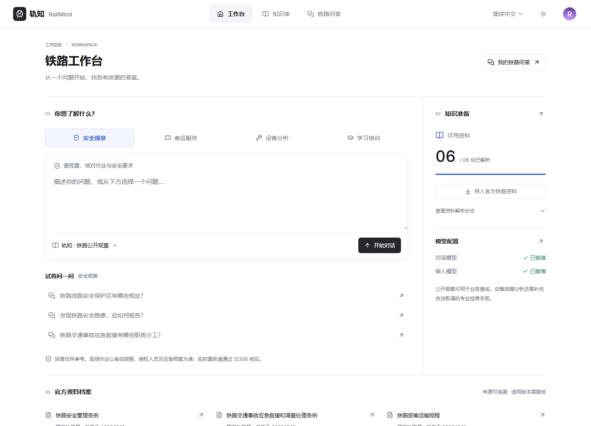
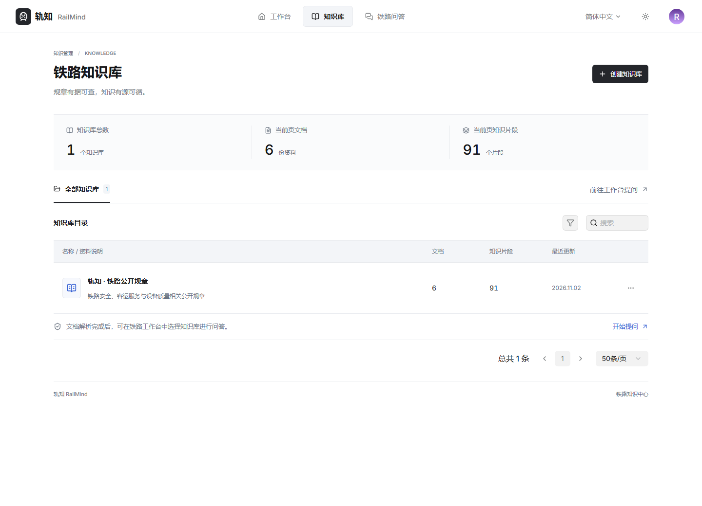
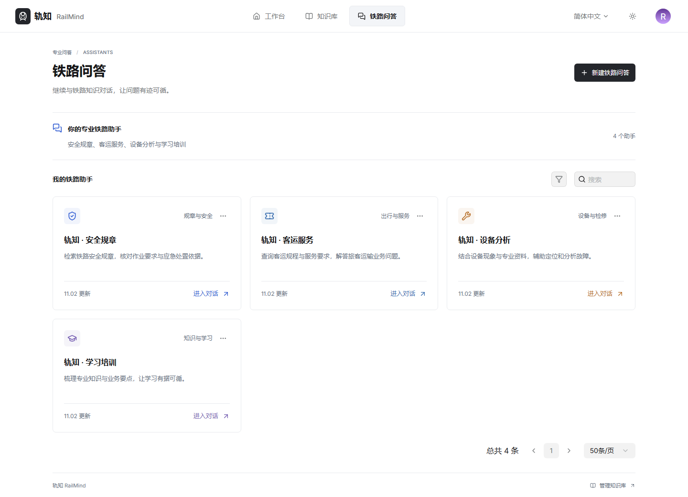
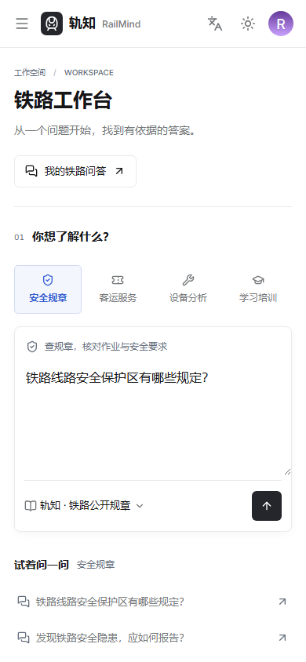

# 轨知 RailMind

本仓库基于 RAGFlow 改造为铁路知识与故障分析辅助智能体，提供安全规章、客运服务、设备背景采集和学习培训四个场景。界面采用白底、深灰文字与少量蓝色重点，保留知识库、检索、引用问答和会话管理，精简通用推广与冗余入口。

项目功能、官方资料来源、运行方法和验证边界见 [铁路智能体说明](docs/railway-agent.md)。六份国家铁路局公开资料存档位于 `web/public/railway/`，可从工作台导入个人知识库；现场作业仍以有效规程和授权人员为准。

## 优化前版本备份：2026 年 11 月 15 日

本次保存聊天模式优化前的现有源码，包含 Go 后端、React 前端、铁路资料与演示配置、本地启停脚本，以及已有的生图和语音集成。

- 已保存的会话支持通过 `@生图` 生成图片、连续编辑，通过 `@语音` 生成语音回答或明确要求的短歌；生成的媒体随回答保留在会话中。
- 生图使用 `gpt-image-2.5-sunburst`；本地语音使用 Qwen3-TTS 的 Serena 音色，唱歌使用 ACE-Step 并传入合成的 Serena 参考音频。
- 输入框支持多附件、粘贴截图、拖入图片和失败上传重试；图片理解需要具备视觉能力的对话模型。
- [聊天模式优化方案](docs/chat-mode-optimization-proposal.zh-CN.md)中的可靠性、任务调度、模型路由和资源管理改造属于后续工作，不计入本次备份的已实现功能。

这是源码备份，不是正式发布或新一轮验收结果。本地工作区仍有未完成的上游合并，备份保存当前磁盘文件内容，不替代合并处理。下方 11 月 14 日的检查记录仅说明此前验证，本次快照尚未重新执行这些检查。

已配置好的 Windows 本机环境可在仓库根目录启动和关闭：

```powershell
.\tools\scripts\start-local-project.ps1
.\tools\scripts\stop-local-project.ps1
```

启动后访问 `http://localhost/`。脚本依赖已准备的 Docker 环境、`bin/` 中的 Go 程序、`web/dist/` 前端构建、本地语音与音乐资源，以及 `.cache/compose.local-startup.yml`。具体准备与使用方法见[本地媒体说明](docs/chat-media-local.md)和[本地启动说明](docs/ai-local-startup-guide.md)。

Git 备份不包含 Docker 数据卷、数据库、上传和生成的对象、被忽略的程序与模型文件、缓存，以及私有的 `docker/.env` 和 `.run/chat-media.env` 凭据。本次提交排除 `docker/.env`，本机文件继续保留；其他机器可从 `docker/.env.example` 开始配置，并单独填写凭据。仅恢复源码快照不能完整恢复本机服务和业务数据。

### 队友首次配置

全新克隆后，在仓库根目录准备本机私有配置：

```powershell
Copy-Item docker/.env.example docker/.env
New-Item -ItemType File -Path docker/.env.local
```

编辑 `docker/.env`：替换示例密码，填写自己的 API Key，并将 `RAGFLOW_IMAGE` 设置为根据本仓库构建或已取得的镜像。模板包含数据库、存储、队列、应用端口和可选媒体配置。Ollama、语音及音乐引擎需单独准备，仅填写环境变量不会自动安装或注册模型。

之后按 [Docker 部署说明](docker/README.md)检查 Compose 配置并启动服务。Windows 媒体启停脚本还需要上述本地资源，全新克隆不会自带这些文件。不要提交 `.env` 和 `.env.local`。

## 此前更新：2026 年 11 月 14 日

- 两处“新建铁路问答”统一进入工作台并聚焦问题框，复用场景、知识库和默认模型配置。
- 创建请求期间防止重复点击；失败后保留问题和设备背景，便于重试。
- 助手卡片按保存的领域和场景分类，给普通助手改名不会启用铁路规则。
- Go 创建服务增加场景、模型及已完成解析且有知识片段的资料校验；后端执行结果仍待环境恢复后确认。
- 进入聊天页只预填首问，检查内容后需要手动发送。

配套文档：[用户使用说明 HTML](docs/railmind-user-manual.zh-CN.html)（[Markdown 原文](docs/railmind-user-manual.zh-CN.md)）· [后续优化建议](docs/railmind-upgrade-proposal.zh-CN.md) · [优化进度与验证记录](docs/railmind-optimization-progress.md)。建议书中的后续任务不代表已经实现。

使用说明包含首次操作、各功能与子功能介绍、按钮作用、参数解释、示例和排错。第 16～26 章按页面详解工作台、知识库、聊天、知识成果、工作流、数据处理流程、编译算子、数据源、聊天渠道、管理和术语。在浏览器中打开 HTML 可搜索目录、离线阅读和打印；GitHub 页面展示的是 HTML 源码。维护人员安装前端依赖后，可运行 `node tools/scripts/render-user-manual.cjs` 从 Markdown 重新生成 HTML。

## 界面预览

- **铁路工作台**：选择业务场景与知识库，输入问题，同时查看资料解析进度和模型就绪状态。
- **铁路知识库**：采用资料列表，集中查看文档数、知识片段和更新时间，支持搜索、筛选、创建、重命名和删除。
- **铁路问答**：按场景展示助手入口，进入对话后查看历史、引用和设置，与知识库管理形成明确区分。
- **移动端**：页面采用自适应布局；当前手机对话及设置流程仍需实际验收。

以下为此前版本的演示数据截图，不作为本轮更新的验收依据，也不代表模型评测结果。

### 铁路工作台



### 铁路知识库



### 铁路问答



<details>
<summary>查看手机对话界面</summary>



</details>

## 快速体验

先按[源码启动指南](docs/develop/launch_ragflow_from_source.md)启动 Go 后端及依赖服务，再启动前端：

```bash
cd web
npm ci
npm run dev
```

访问 Vite 输出的地址。默认端口为 `9222`，被占用时自动选择其他端口；开发代理连接 Go API 的 `9380` 和管理 API 的 `9381`。

登录后配置默认对话模型和嵌入模型，从工作台导入官方铁路资料，等待解析完成，再选择知识库发起对话。设备分析需要补充适用的专业手册和现场背景，公开规章不能单独支持确定性故障诊断。

2026 年 11 月 14 日，开发工作区通过 35 项前端针对性测试、生产构建及本轮前端文件检查，其全仓 TypeScript 检查仍有 46 条既有诊断。基于 GitHub main 单独整理的上传版本通过接口测试数据下的桌面和手机入口检查，全仓类型检查为 197 条诊断。受后端环境限制，Go 测试与真实检索、模型链路尚未验收。两个版本的结果及限制见[优化进度](docs/railmind-optimization-progress.md)。

下方保留上游 RAGFlow 的说明与归属信息。

---

<div align="center">
<a href="https://cloud.ragflow.io/">

</a>
</div>

<p align="center">
  <a href="./README.md"></a>
  <a href="./README_zh.md"></a>
  <a href="./README_tzh.md"></a>
  <a href="./README_ja.md"></a>
  <a href="./README_ko.md"></a>
  <a href="./README_fr.md"></a>
  <a href="./README_id.md"></a>
  <a href="./README_pt_br.md"></a>
  <a href="./README_ar.md"></a>
  <a href="./README_tr.md"></a>
  <a href="./README_ru.md"></a>
</p>

<p align="center">
    <a href="https://x.com/intent/follow?screen_name=infiniflowai" target="_blank">
        
    </a>
    <a href="https://cloud.ragflow.io" target="_blank">
        
    </a>
    <a href="https://hub.docker.com/r/infiniflow/ragflow" target="_blank">
        
    </a>
    <a href="https://github.com/infiniflow/ragflow/releases/latest">
        
    </a>
    <a href="https://github.com/infiniflow/ragflow/blob/main/LICENSE">
        
    </a>
</p>

<h4 align="center">
  <a href="https://cloud.ragflow.io">Cloud</a> |
  <a href="https://ragflow.io/docs/dev/">Document</a> |
  <a href="https://github.com/infiniflow/ragflow/issues/12241">Roadmap</a> |
  <a href="https://discord.gg/NjYzJD3GM3">Discord</a>
</h4>

<div align="center" style="margin-top:20px;margin-bottom:20px;">

</div>

<div align="center">
<a href="https://trendshift.io/repositories/9064" target="_blank"></a>
</div>

<details open>
<summary><b>📕 目录</b></summary>

- 💡 [RAGFlow 是什么？](#-RAGFlow-是什么)
- 🎮 [快速开始](#-快速开始)
- 🔥 [近期更新](#-近期更新)
- 🌟 [主要功能](#-主要功能)
- 🔎 [系统架构](#-系统架构)
- 🏠 [本地部署](#-本地部署)
- 📚 [技术文档](#-技术文档)
- 📜 [路线图](#-路线图)
- 🏄 [开源社区](#-开源社区)
- 🙌 [贡献指南](#-贡献指南)
- 🤝 [商务合作](#-商务合作)
- 👥 [加入社区](#-加入社区)

</details>

## 💡 RAGFlow 是什么？

[RAGFlow](https://ragflow.io/) 是一款领先的开源检索增强生成（[RAG](https://ragflow.io/basics/what-is-rag)）引擎，通过融合前沿的 RAG 技术与 Agent 能力，为大型语言模型提供卓越的上下文层。它提供可适配任意规模企业的端到端 RAG 工作流，凭借融合式[上下文引擎](https://ragflow.io/basics/what-is-agent-context-engine)与预置的 Agent 模板，助力开发者以极致效率与精度将复杂数据转化为高可信、生产级的人工智能系统。

## 🎮 快速开始

请登录网址 [https://cloud.ragflow.io](https://cloud.ragflow.io) 体验云服务。

如果想在本地部署，请参阅[本地部署](#-本地部署)。

<div align="center" style="margin-top:20px;margin-bottom:20px;">


</div>

## 🔥 近期更新

- 2026-09-30 发布 RAGFlow 1.0.0-rc1。
- 2026-09-10 支持通过 Sitemap 接入网站内容。
- 2026-08-19 推出知识编译，支持在文档级和知识库级生成 Wiki、Graph、Tree、PageIndex、Mind Map、Timeline 及 Skills。
- 2026-08-19 推出 Agentic RAG，支持 Low、Medium、High、Ultra 四种思考模式。
- 2026-07-02 支持 Google BigQuery 数据源接入与增量同步。

更多更新请参阅[完整发布记录](https://ragflow.io/docs/dev/release_notes)。

## 🌟 主要功能

### 🍭 **"Quality in, quality out"**

- 基于深度文档理解，能够从各类复杂格式的非结构化数据中提取真知灼见。
- 真正在无限上下文（token）的场景下快速完成大海捞针测试。

### 🍱 **基于模板的文本切片**

- 不仅仅是智能，更重要的是可控可解释。
- 多种文本模板可供选择。

### 🧩 **知识编译（Knowledge Compilation）**

- 支持文档级和知识库级编译，将原始内容组织为结构化的知识产物。
- 通过编译模板生成 Wiki、Graph、Tree、PageIndex、Mind Map、Timeline 及 Skills，满足不同的知识组织和复用需求。
- 支持配置编译模型与处理规则，并查看、更新和重新生成知识产物。

### 🧠 **Agentic Retrieval**

- 面向复杂问题进行多步检索：模型会分析问题，并在需要时执行问题拆解、知识检索和证据核验。
- 通过多轮检索与推理获取更完整的上下文，帮助生成有依据的回答。
- 支持 Low、Medium、High、Ultra 思考模式，可按问题复杂度控制检索和推理深度。

### 🌱 **有理有据、最大程度降低幻觉（hallucination）**

- 文本切片过程可视化，支持手动调整。
- 有理有据：答案提供关键引用的快照并支持追根溯源。

### 🍔 **兼容各类异构数据源**

- 支持丰富的文件类型，包括 Word 文档、PPT、Excel 表格、TXT 文件、图片、PDF、影印件、复印件、结构化数据、网页等。

### 🛀 **全程无忧、自动化的 RAG 工作流**

- 自动化的 RAG 工作流可以支持从个人应用乃至超大型企业的各类生态系统。
- 大语言模型 LLM 以及向量模型均支持配置。
- 基于多路召回、融合重排序。
- 提供易用的 API，可以轻松集成到各类企业系统。

## 🔎 系统架构

<div align="center" style="margin-top:20px;margin-bottom:20px;">
  
</div>

## 🏠 本地部署

本地部署提供 Docker 部署和源码启动两种方式：Docker 适合快速体验、集成测试和生产部署；源码启动适合 RAGFlow 开发和调试。Docker 部署无需安装 Go 编译器，源码启动需要安装 `go.mod` 指定版本的 Go 编译器；前端开发还需要 Node.js 和 npm。

### 🐳 Docker 部署

#### 📝 Docker 部署前提条件

- 建议起步配置：4 核 CPU、16 GB 内存和 50 GB 可用磁盘。实际资源需求取决于文档引擎、数据规模、解析任务和并发量；启用本地模型或其他额外组件时，请同时满足相应组件的资源要求。
- Docker ≥ 24.0.0，Docker Compose ≥ v2.26.1。

> ⚠️ **提示：** 如果你尚未在本机安装 Docker（Windows、macOS 或 Linux），可以参考 [Install Docker Engine](https://docs.docker.com/engine/install/) 自行安装。

#### 🚀 启动服务器

1. 如果使用 Elasticsearch，将 Docker 宿主机的 `vm.max_map_count` 设置为至少 262144。使用 Infinity 时则不需要执行此步骤：

   > 如需确认 `vm.max_map_count` 的大小：
   >
   > ```bash
   > sysctl vm.max_map_count
   > ```
   >
   > 如果使用 Elasticsearch 且 `vm.max_map_count` 的值小于 262144，可以进行重置：
   >
   > ```bash
   > # 这里我们设为 262144:
   > sudo sysctl -w vm.max_map_count=262144
   > ```
   >
   > 你的改动会在下次系统重启时被重置。如果希望做永久改动，还需要在 **/etc/sysctl.conf** 文件里把 `vm.max_map_count` 的值再相应更新一遍：
   >
   > ```bash
   > vm.max_map_count=262144
   > ```

2. 克隆仓库：

   ```bash
   git clone https://github.com/infiniflow/ragflow.git
   ```

3. 切换到发布标签并使用 Docker Compose 启动服务器：

   进入仓库中的 Docker 部署目录。

   ```bash
   cd ragflow/docker
   ```

   切换到 `v1.0.0` 发布标签。

   ```bash
   git checkout v1.0.0
   ```

   在启动 RAGFlow 服务及其依赖服务。

   ```bash
   docker compose -f docker-compose.yml up -d
   ```

   > 💡 **镜像下载提示：** 如果无法从默认仓库拉取镜像，请先在 `docker/.env` 中将 `RAGFLOW_IMAGE` 设置为以下镜像源之一，并保留 `v1.0.0` 标签：
   >
   > - 华为云：`swr.cn-north-4.myhuaweicloud.com/infiniflow/ragflow:v1.0.0`
   > - 阿里云：`registry.cn-hangzhou.aliyuncs.com/infiniflow/ragflow:v1.0.0`

   默认 MySQL 配置下，镜像入口会先执行数据库迁移，再启动 Admin、Syncer、Ingestor 和 API 等服务。

   > RAGFlow 开源版 1.0 的 DeepDoc 版面分析、OCR 和表格识别使用 CPU 推理。

4. 服务器启动成功后再次确认服务器状态：

   使用 `docker ps` 检查依赖服务状态；依赖服务显示 `healthy` 且 RAGFlow 容器持续运行后，通过 HTTP 接口判断 RAGFlow 是否就绪（RAGFlow 容器本身未定义 Compose healthcheck）：

   ```bash
   curl -f http://localhost/api/v1/system/healthz
   ```

   返回 HTTP 200 后，再访问 Web 页面。如果修改了 `SVR_WEB_HTTP_PORT`，请将健康检查地址中的端口替换为对应值。

   如果服务启动异常，再查看对应容器日志：

   ```bash
   docker logs --tail 50 ragflow-cpu
   ```

5. 在你的浏览器中输入你的服务器对应的 IP 地址并登录 RAGFlow。
   > 上面这个例子中，您只需输入 http://IP_OF_YOUR_MACHINE 即可：未改动过配置则无需输入端口（默认的 HTTP 服务端口 80）。

6. 登录 RAGFlow 后，在模型提供商页面添加 LLM、Embedding 和 Reranker，并填写对应的模型名称、服务地址和 API key。

   > 详见 [llm_api_key_setup](https://ragflow.io/docs/dev/llm_api_key_setup)。

   _好戏开始，接着奏乐接着舞！_

详情请见 [快速入门指南](./docs/quickstart.mdx)。

#### ⚙️ Docker 配置与调整

Docker 部署使用 `docker/.env` 和 `docker/docker-compose.yml`。镜像、端口、密码、文档引擎及模型镜像源请按[Docker 配置说明](./docker/README.md)修改；平台支持（注意：macOS 暂不受支持）请参阅[Go Docker 镜像构建与平台支持指南](./docs/develop/build_docker_image.mdx)。源码构建 Docker 镜像请参阅[Go Docker 镜像构建与平台支持指南](./docs/develop/build_docker_image.mdx)。

切换文档引擎、修改配置后重启服务，以及保留或清理已有数据的操作，也请按照上述 Docker 配置文档执行。

### 🔨 以源代码启动

#### 📝 源码启动前提条件

1. 克隆仓库，并安装 `go.mod` 中指定版本的 Go 编译器（当前为 Go 1.27）、Clang 20、LLD 20、CMake ≥ 4.0、PCRE2 开发文件 CGO 依赖的静态库；[build.sh](./build.sh) 会设置所需的构建参数。

   ```bash
   git clone https://github.com/infiniflow/ragflow.git
   cd ragflow
   ```

2. 运行依赖下载脚本，准备 Go 构建所需链接的原生静态库（`download_dev_deps.py`）与后端运行时加载的模型/分词器资源（`download_deps.py`）：

   ```bash
   uv run tools/scripts/download_dev_deps.py
   uv run deps/download_deps.py
   ```

   `download_dev_deps.py` 拉取并解压 pdfium、pdf_oxide、office_oxide、onnxruntime 等到 `~/ragflow-native-libs`；`download_deps.py` 拉取 cl100k 词表、DeepDoc 模型与 embedding 分词器资源到 `deps/`。两个脚本均为 Python 脚本，`uv run` 会自动安装其声明的依赖（`requests`，模型与分词器下载还需 `huggingface-hub`）。如果已通过其他方式准备好相同资源，可跳过这一步。Go 服务从仓库根目录启动时会自动查找 `internal/rag/res/deepdoc`；如需从其他目录启动，请将 `DEEPDOC_MODEL_DIR` 设为该目录的绝对路径。

3. 编译：

   ```bash
   ./build.sh --all
   ```

4. 启动本地依赖服务，并确认 **conf/service_conf.yaml** 中的主机与端口对应宿主机可访问的地址。如果使用 Elasticsearch，还需先将 Docker 主机的 `vm.max_map_count` 设为至少 `262144`。

   ```bash
   sudo sysctl -w vm.max_map_count=262144
   docker compose --env-file docker/.env -f docker/docker-compose-base.yml up -d --wait es01 mysql minio nats kvrocks
   ```

5. 数据迁移：

   ```bash
   ./bin/ragflow_server --migrate
   ```

6. 启动 4 个终端分别启动 4 个服务：

   终端 1：启动 Admin，监听端口 `9381`。

   ```bash
   ./bin/ragflow_server --admin
   ```

   ```bash
   ./bin/ragflow_server --ingestor
   ```

   终端 3：启动 Syncer。

   ```bash
   ./bin/ragflow_server --syncer
   ```

   终端 4：启动 API，监听端口 `9380`。

   ```bash
   ./bin/ragflow_server --api
   ```

   各启动参数的作用如下：

   - `--migrate`：执行数据库迁移，完成后即可退出。
   - `--admin`：启动 Admin 服务，负责管理和初始化操作。
   - `--ingestor`：启动 Ingestor 服务，负责数据摄取和解析任务。
   - `--syncer`：启动 Syncer 服务，负责外部数据源的数据同步任务。
   - `--api`：启动 API 服务，为 Web 和 SDK 提供 API 接口。

7. 仅在前端开发时安装 Node.js 和 npm，然后启动 React 前端：

   ```bash
   cd web
   npm install
   ```

   服务启动后，运行下面命令来确认 API 服务已就绪：

   ```bash
   curl -f http://127.0.0.1:9380/api/v1/system/healthz
   ```

   返回 HTTP 200 表示 API 可以正常响应。前端 和 DeepDoc 的完整验证步骤请参阅[从源代码启动服务](./docs/develop/launch_ragflow_from_source.md#5-verify-the-startup)。

详情请见 [从源代码启动服务](./docs/develop/launch_ragflow_from_source.md)。

## 📚 技术文档

- [Quickstart](https://ragflow.io/docs/dev/)
- [Configuration](https://ragflow.io/docs/dev/configurations)
- [Release notes](https://ragflow.io/docs/dev/release_notes)
- [User guides](https://ragflow.io/docs/category/user-guides)
- [Developer guides](https://ragflow.io/docs/category/developer-guides)
- [References](https://ragflow.io/docs/dev/category/references)
- [FAQs](https://ragflow.io/docs/dev/faq)

## 📜 路线图

详见 [RAGFlow Roadmap 2026](https://github.com/infiniflow/ragflow/issues/12241) 。

## 🏄 开源社区

- [Discord](https://discord.gg/NjYzJD3GM3)
- [X](https://x.com/infiniflowai)
- [GitHub Discussions](https://github.com/orgs/infiniflow/discussions)

## 🙌 贡献指南

RAGFlow 只有通过开源协作才能蓬勃发展。秉持这一精神，我们欢迎来自社区的各种贡献。如果您有意参与其中，请查阅我们的[贡献者指南](https://ragflow.io/docs/dev/contributing)。

## 🤝 商务合作

- [预约咨询](https://aao615odquw.feishu.cn/share/base/form/shrcnjw7QleretCLqh1nuPo1xxh)

## 👥 加入社区

扫二维码添加 RAGFlow 小助手，进 RAGFlow 交流群。

<p align="center">
  
</p>
