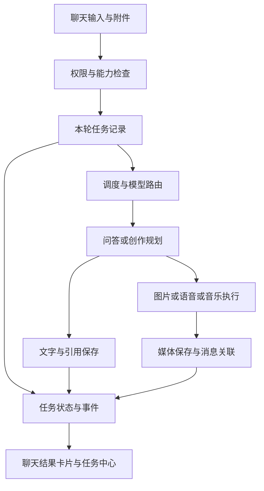

# 聊天模式多模态优化建议书

版本：V1.1（AI 执行与验收约束版）  
编写日期：2026 年 11 月 15 日  
适用范围：当前工作区中的 Go 聊天后端与 React 聊天前端  
定位：够用、够强、便于维护；包含任务中心、复杂任务调度和多模型自动切换

**阅读顺序：** 第 1～15 节解释现状、目标与方案；第 16～22 节明确执行范围、工作顺序、技术契约、补充测试和交付证据。实施 AI 应先读第 16、17、22 节，再按工作包回到相关设计章节。

**本版新增：** 28 项必做需求、明确排除项、10 个有依赖的工作包、状态/API/事件/调度契约、扩展验收用例、执行台账模板和可直接交给 AI 的实施指令。设计仍需由实施时的代码核对；本文不承诺 AI 零错误或模型生成内容绝对正确，而是要求遗漏、偏差和未验证项可被发现。

## 1. 建议结论与实施边界

当前聊天模式已经具备继续升级的基础，没有必要推倒重做。建议保留现有聊天入口、多附件交互、知识库问答、生图编辑、固定音色语音与唱歌能力，先补齐可靠性，再把耗时的多模态操作纳入可恢复任务，最后接入有明确规则的调度和模型自动切换。

后续升级围绕四个结果展开：

1. **用户能知道发生了什么。** 附件是否读到、现在处于哪一步、为什么失败、是否已经切换模型，都有明确反馈。
2. **已经完成的工作不会轻易丢失。** 文字回答成功后，即使语音失败也能保留；刷新后能找到任务；重试尽量复用已有结果。
3. **复杂请求可以有序完成。** 图片、语音、歌曲、问答按依赖关系执行，避免争抢本地 GPU，也避免一个长任务挡住所有短请求。
4. **模型能按能力与状态切换。** 支持视觉输入、服务故障、限流等场景的自动选路，同时限制费用、切换次数和输出变化。

任务中心、调度和自动切换均纳入建设范围，但采用满足当前规模的实现：复用现有 Go 服务、数据库、对象存储及 NATS 基础设施，不额外引入一套工作流平台，不建设任意流程拖拽编辑器。

**本次交付仅为建议书，没有修改业务代码，也没有启动模型调用、迁移数据库或部署服务。** 下文接口与字段尚未实现；第 16～22 节中的“必须”约束后续获授权的实施，不表示本次已授权执行升级。工期为估算，配置初值需验证。

## 2. 评估依据与可信边界

本建议书依据当前磁盘文件进行静态阅读，覆盖聊天输入、附件上传与读取、SSE 消息处理、媒体规划与生成、历史保存、资源读取与删除、模型工厂，以及相关测试。

本次没有运行浏览器实测、真实模型调用、性能压测或测试套件。因此：

- “已确认”表示可以从当前代码路径直接判断。
- “风险”表示代码允许出现该情形，实际发生频率仍需验证。
- “建议目标”是后续验收要求，不是当前性能结论。
- 模型名称及尺寸限制来自仓库配置，不表示已核验上游供应商当前的完整能力。

首次评估时，工作区存在较多在途修改及 Git 未合并记录。前文代码观察对应该次可读快照，后续状态可能变化。正式开发前应先确定一个可构建的基线，再核对这里的函数位置和测试结果；不应把本文视为当前工作区已经通过发布验收的证明。

## 3. 已经做好的能力，应当保留

| 能力 | 当前实现 | 后续处理 |
| --- | --- | --- |
| 多附件输入 | 支持多文件、截图粘贴、拖入图片、失败重试；上传期间可继续输入 | 保留交互，补齐顺序、能力提示和读取失败反馈 |
| 纯附件提问 | 没有文字也能发送，并补充默认分析问题 | 保留，不要求用户重复输入“分析这张图” |
| 图片理解 | 附件读取后转换为多模态内容，支持视觉模型调用 | 保留，完善能力判定和上下文预算 |
| 生图与参考图编辑 | `@生图` 支持文生图、上传参考图、继续修改上一张图 | 保留，补充明确的编辑目标与版本关系 |
| 需求保真 | 创作计划之外，仍把用户最新原话交给图像模型；保存 `image_plan` | 保留，这是减少规划阶段丢失细节的有效措施 |
| 语音回答 | `@语音` 先形成回答，再合成音频；知识问答可保留引用 | 保留，改为文字与音频分阶段交付 |
| 唱歌 | 显式唱歌意图进入音乐流程，先合成固定音色参考，再提交音乐任务 | 保留，纳入调度与任务恢复 |
| 媒体持久化 | 生成资源写入对象存储，消息保存受鉴权链接；数据库提交失败会尝试清理资源 | 保留，扩展为完整的资源生命周期 |
| 页面内切换 | 模块级聊天状态可让流式请求在页面卸载后继续更新 | 保留；这与整页刷新后恢复任务是两种能力 |
| 基础防护 | 资源名称限制、会话权限校验、上传归属校验、响应大小限制、禁重定向、上游错误脱敏 | 延续这些约束，不应在升级中丢掉 |

已有测试覆盖了媒体指令、WAV 与图片响应、参考图传递、创作计划保存、语音知识路由、音乐取消、上传失败重试等场景。后续以这些测试为回归起点，补齐本文指出的边界，不需要重新搭一套重复测试体系。

需要明确的能力边界：后端已经有 ASR 转写接口，但本次查看的聊天输入组件没有完整的录音交互；普通聊天附件读取路径明确把视频标记为不支持分析。因此不能把“可上传媒体”和“已经理解所有媒体”当成同一件事。

## 4. 代码核实后建议处理的问题

优先级说明：**P0** 为可靠性基础，进入下一阶段前完成；**P1** 为本轮升级主体；**P2** 为主体完成后的体验增强。优先级不等同于已经发生生产事故。

### 4.1 流式请求结束与业务成功没有严格区分 — P0

**已确认：** `parseCompletionEventStream` 对非取消类读取异常直接结束循环，只向上层交付 `payload.data`，没有处理外层业务错误码。`runChatCompletionStream` 默认 `ok = true`，并未要求收到成功终态后才返回成功。后端的 `sendSSEError` 则会通过 SSE 发送错误码和带 `**ERROR**` 的正文。

**影响：** 某些异常可能在消息中出现错误文字，但前端状态仍被当作成功；连接提前结束时，也可能没有明确的“回答未完成”状态。失败输入恢复、重试入口和后续任务统计都会受影响。

**建议：** 将成功、失败、主动取消、连接中断分开处理。保留已经收到的正文；没有成功终态的异常结束不能算成功。按响应状态与内容类型区分 JSON 错误和 SSE，避免对整个 SSE 响应复制一份再尝试当 JSON 读取。

**验收：** 正常结束、业务错误、网络中断、无正文异常结束、用户取消分别得到正确状态；错误消息不再靠正文包含某个字符串来判定。

代码依据：[流解析](D:/ragflow/web/src/services/chat-completion-stream.ts:100)、[流执行](D:/ragflow/web/src/pages/next-chats/chat-stream/run-stream.ts:56)、[服务端错误事件](D:/ragflow/internal/service/chat_session.go:1834)。

### 4.2 附件读取失败或模型不支持看图时，可能继续按缺失内容回答 — P0

**已确认：** `GetFileContents` 遇到部分存储读取失败会跳过文件；`splitChatAttachments` 遇到读取错误会记录日志后返回空附件；`gateImageAttachments` 会丢弃非视觉模型的图片。生图参考附件路径有更严格的数量检查，但普通聊天路径没有等价的完整反馈。

**影响：** 用户看到上传成功，容易认为模型已经读到全部材料，实际可能遗漏文件或图片。对比两张图、依据文档回答时尤其容易产生误解。

**建议：** 返回逐附件处理结果，至少区分“可用、读取失败、格式不支持、模型能力不支持”。当前轮附件缺失时默认先提示并保留草稿；需要继续仅用可读附件时，由用户明确选择。视觉能力不足时按第 9 节的模型路由规则处理，不再静默忽略图片。

**验收：** 删除一个已上传对象、提交无权访问的描述符、选择纯文本模型上传图片，都能得到准确提示，不能呈现成“已根据全部附件完成分析”。

代码依据：[附件读取](D:/ragflow/internal/service/file/file_content.go:121)、[聊天附件处理](D:/ragflow/internal/service/chat_pipeline.go:1835)、[图片能力门控](D:/ragflow/internal/service/chat_pipeline.go:2245)。

### 4.3 上传失败后重试可能改变参考图片顺序 — P0

**已确认：** 上传结果保存在 `Map<File, UploadResponseDataType>` 中，发送列表取 `Map.values()`，顺序取决于成功插入的先后。

**具体情形：** 选择 A、B 两张图；A 上传失败，B 成功；重试 A 成功后，结果列表可能为 B、A。界面中用户理解的“第一张”与后端收到的第一张可能不同。

**建议：** 在用户选入附件时分配稳定的本地 ID 与顺序号，成功回调只更新状态及服务端 ID。重试不改变位置。若支持拖动排序，应把排序后的顺序作为发送顺序，并在预览上显示“图 1、图 2”。

**验收：** A 失败、B 成功、A 重试后，发送仍为 A、B；继续编辑上一张生成图时，底图与新增参考图的排序符合明确规则。

代码依据：[上传队列与结果列表](D:/ragflow/web/src/pages/next-chats/hooks/use-upload-file.ts)。

### 4.4 语音生成失败，会连带丢掉已经生成的文字回答 — P0

**已确认：** `completeMedia` 先生成回答，再调用语音或音乐服务，成功后才存储资源并提交整轮消息。合成失败会直接返回错误。

**影响：** 用户等待较久后只得到失败提示，原本已经成功生成的文字与引用没有作为本轮有效结果保存；重试又可能重新检索和生成回答。

**建议：** 保存并交付文字与引用后，再更新音频状态。音频失败时保留文字，显示“语音生成失败，重试语音”。重试语音使用同一份文本与音色参数，不重跑问答。歌曲可以先显示歌词，再等待音乐结果。

**验收：** 在文字生成成功后关闭 TTS，文字和引用仍可刷新查看；恢复 TTS 后只重跑合成阶段，文字内容不发生变化。

代码依据：[媒体执行与提交顺序](D:/ragflow/internal/service/chat_media.go:57)。

### 4.5 长时间媒体操作缺少独立于连接的任务状态 — P1

**已确认：** 生图和语音主路径在请求内等待，媒体完成后才发送最终结果；相关 HTTP 调用允许等待至 10 分钟。音乐服务有上游任务 ID 和取消逻辑，但聊天侧没有对应的完整持久化任务中心。当前聊天 SSE handler 也未提供媒体阶段心跳。

**影响：** 页面内切换可以继续接收，但整页刷新、进程重启、代理超时后的恢复能力有限。用户不知道在规划、排队、推理还是保存，也容易重复提交。

**建议：** 按第 7 节建设任务中心，保留已有请求取消能力，并增加独立任务查询、阶段状态、重新连接和显式取消。不能把“停止接收消息”直接当作“上游已经停止计算”。

代码依据：[媒体最终返回](D:/ragflow/internal/service/chat_session.go:1240)、[媒体请求超时](D:/ragflow/internal/service/chat_media.go:451)、[音乐任务轮询](D:/ragflow/internal/service/chat_media_music.go:22)、[SSE handler](D:/ragflow/internal/handler/chat_session.go:256)。

### 4.6 图片编辑目标与媒体归属依赖 Markdown 内容 — P1

**已确认：** 上一张图片通过匹配 `` 定位；资源读取也会检查会话正文是否含对应链接。当前 `image_plan` 已保存，但没有独立的编辑来源关系。

**影响：** 难以可靠支持“改第二张”“回到上一版”“比较两个版本”；改变文案或展示格式也可能影响后台资源定位。

**建议：** 图片、音频使用结构化资源 ID 关联消息；图片保留父版本、使用的参考图、尺寸和创作计划。聊天正文负责展示，不再负责定义资源归属。用户可以点击图片选择“继续编辑”，明确目标后再发送修改要求。

代码依据：[历史图片定位](D:/ragflow/internal/service/chat_media_plan.go:285)、[资源读取](D:/ragflow/internal/service/chat_media.go:488)、[媒体渲染识别](D:/ragflow/web/src/components/markdown-content/index.tsx:70)。

### 4.7 删除聊天记录后，生成媒体的清理链路不完整 — P1

**已确认：** 会话删除会清理上传附件所在的 downloads 桶；生成媒体存入单独的 `chat-media` 桶。当前该桶的显式删除调用用于数据库提交失败后的补偿，没有看到与会话及消息删除配套的生成资源清理。

**影响：** 删除聊天内容可以使资源无法再按原会话链接访问，但不等于对象存储字节已经删除。长期使用可能积累无引用资源。

**建议：** 删除先解除消息与资源关联，事务提交后异步清理无引用对象。清理失败记录并重试；编辑版本、多条消息复用同一资源时，要确认没有有效引用再删除。补偿清理不能静默失败后永远失联。

**验收：** 删除整会话、删除一轮消息、数据库保存失败、存储删除失败均有明确结果；被其他有效消息引用的图片不会误删。

代码依据：[会话删除](D:/ragflow/internal/service/chat_session.go:274)、[上传附件清理](D:/ragflow/internal/service/chat_session.go:394)、[消息删除](D:/ragflow/internal/service/chat_session.go:527)、[媒体保存补偿](D:/ragflow/internal/service/chat_media.go:153)。

### 4.8 历史附件与视觉上下文预算需要统一 — P1

**已确认：** `chatHistoryMessage` 会重新解析历史用户附件，但只使用返回的图片，忽略解析出的文档文本。RAG 路径先进行 `messageFitIn`，再补入历史多模态内容；当前 `countAllTokens` 主要统计字符串内容。

**影响：** 追问之前上传的文档时，不一定保留原始文本依据；多轮图片重复进入上下文时，文本预算不能完整反映实际输入量。这里不能据此断言所有聊天都会超限，但值得集中处理。

**建议：** 为会话保留可重新定位的附件引用与解析结果，按当前问题选取必要页面、片段和图片；先形成最终多模态上下文，再估算总预算。优先保留最新问题、明确引用的附件、必要引用依据，历史无关图片可以退出本轮上下文。

**验收：** 第一轮上传文档、第二轮追问其中某项指标仍能定位依据；多图长会话不会因无差别重放历史附件而持续膨胀。

代码依据：[历史附件处理](D:/ragflow/internal/service/chat_pipeline.go:2748)、[上下文预算与转换顺序](D:/ragflow/internal/service/chat_pipeline.go:1028)、[Token 统计](D:/ragflow/internal/service/chat_pipeline.go:2717)。

### 4.9 语音清洗与播放路径存在行为差异 — P1/P2

**已确认：** `@语音` 使用后端 Markdown AST 清洗，并保留代码内容；朗读按钮在前端用正则清洗且删除代码块。朗读按钮还会调用租户默认 TTS，而 `@语音` 通过本地配置端点执行。音频组件通过鉴权 fetch 完整读取 Blob 后播放，因此 `preload="metadata"` 不会阻止前面的完整下载。

**建议：** 提供统一的朗读文本策略，明确代码、表格、引用、URL 如何表达；对已有音频优先直接播放，避免再次合成。统一播放控制，播放新消息时停止上一条。长音频再考虑分段及 Range 支持，短音频阶段不必上来就建设实时音频协议。

代码依据：[后端语音文本](D:/ragflow/internal/service/chat_media.go:289)、[朗读 hook](D:/ragflow/web/src/hooks/use-speech.ts)、[音频组件](D:/ragflow/web/src/components/chat-media-audio.tsx)、[鉴权资源读取](D:/ragflow/web/src/components/image/index.tsx)、[默认 TTS 接口](D:/ragflow/internal/handler/chat_audio.go:55)。

## 5. 用户侧应形成的使用体验

### 5.1 输入区域保持简单，能力明确可见

保留当前 `@` 快捷命令，同时提供可点击的“生成图片”“语音回答”入口。选择后显示小型模式标签，用户不用记住命令格式，也能随时退出模式。模型、知识库等现有入口继续保留。

附件预览至少显示名称、类型、状态、顺序号。把“上传中”和“已可用于回答”区分开：文件上传成功，并不代表服务端已经完成解析或当前模型能处理它。

上传图片而当前模型不支持视觉时，按当前路由策略给出“将使用支持图片的模型”或“请选择可看图模型”。歌曲、视频等能力必须按实际可用状态展示，服务未启动时在发送前就给出原因。

不必让用户每次选择所有参数。图片默认沿用当前已验证尺寸；修改上一张图默认保留尺寸和未要求修改的内容；语音默认沿用现有固定音色。高级参数放在可展开设置中。

### 5.2 回答过程显示真实阶段

建议的状态文案示例：

| 场景 | 显示内容 |
| --- | --- |
| 语音回答 | 正在查找资料 → 回答已生成 → 正在合成语音 → 可以播放 |
| 图片生成 | 正在整理要求 → 排队中 → 正在生成图片 → 正在保存 |
| 图片编辑 | 已选中第 2 张图片 → 正在编辑 → 新版本已保存 |
| 唱歌 | 歌词已生成 → 正在准备音色参考 → 正在生成歌曲 |
| 自动切换 | 原模型暂时不可用，已切换至允许的备用模型 |
| 部分成功 | 文字已保存，语音生成失败，可单独重试 |

没有上游准确进度时，只显示阶段、等待时间和排队情况，不虚构“已完成 83%”。刷新后显示服务器当前状态，而非重新开始一条动画。

### 5.3 结果卡片只增加实用操作

- 图片：预览、下载、继续编辑、查看版本；需要时选择作为参考图。
- 语音：播放/暂停、进度、下载、重新合成；较长音频再提供倍速与分段。
- 歌曲：歌词、时长、播放、下载、按现有歌词重做；不要默认重写歌词。
- 任务失败：简明原因、已保留的结果、可重试阶段；详细错误放到任务详情。
- 多模型切换：默认只显示实际使用的模型和简短原因；完整尝试记录放详情。

第一版不需要独立素材商城、复杂时间线编辑器或大面积监控面板。

## 6. 建议的整体结构

建议在现有代码上形成以下职责，而非为每种媒体新建一整套后端：



普通文本聊天仍应尽快开始流式输出，不必一律排到长任务队列。可记录轻量的本轮状态；图片、语音、歌曲以及用户明确要求的组合任务进入持久化执行流程。

职责建议：

| 职责 | 应负责 | 不应负责 |
| --- | --- | --- |
| 聊天服务 | 权限、会话、消息、引用、任务入口 | 直接堆叠所有模型协议与排队细节 |
| 任务服务 | 状态、幂等、取消、恢复、结果关联 | 重新实现一套聊天历史 |
| 调度模块 | 并发、资源占用、依赖、重试时间 | 改写用户需求或知识库范围 |
| 模型路由 | 能力筛选、故障切换、预算限制 | 随意改变用户选中的聊天配置 |
| 模型适配层 | 供应商请求、输出规范化、错误分类 | 持有前端状态或绕过租户授权 |
| 资源服务 | 媒体归属、鉴权、读取、删除 | 通过 Markdown 文案猜测对象关系 |

已有模型工厂与任务发布设施可以作为接入点。仓库已有的 ingestion 任务服务属于文档摄取领域，不宜直接把聊天媒体伪装成摄取任务；应复用必要的队列与执行基础，而不是继承全部摄取业务状态。

## 7. 任务中心：本轮必须纳入的升级项

### 7.1 用户功能范围

提供一个轻量任务列表页或抽屉，支持查看“进行中、已完成、失败、已取消”，按会话和类型筛选，并可跳回原消息。

任务详情显示：输入摘要、当前阶段、实际使用模型、等待与执行耗时、已生成结果、失败阶段。支持取消任务、重试失败阶段、查看输出。任务列表不是另一个聊天窗口，回答仍归属于原会话。

第一版不必保存逐 Token 事件。保存阶段变化、模型尝试和结果事件即可，降低状态维护成本。

### 7.2 状态设计

建议任务主状态采用：`queued`、`running`、`cancel_requested`、`succeeded`、`partial_succeeded`、`failed`、`cancelled`。执行阶段单独记录，如 `planning`、`retrieving`、`answering`、`synthesizing`、`generating_image`、`persisting`。

把“部分成功”定义清楚：例如文字和引用已经保存，但音频生成失败；任务详情可重试音频，同时主消息继续可用。执行中的自动重试记录为新的 attempt；终态后的人工重试创建关联的新任务，复用有效的文字与引用，原任务终态不回退。具体以第 18 节为准。

网络断开不直接改变任务终态。上游任务是否仍在执行不明确时，进入核对/恢复阶段；确认失败后再决定重试，避免把未知状态当作失败后立即重复付费调用。

### 7.3 最小数据与接口

以下为建议字段，最终应结合现有实体确定，不要求机械照搬：

| 对象 | 建议字段 |
| --- | --- |
| 任务 | ID、租户、用户、会话、本轮 ID、类型、状态、阶段、版本号、创建/更新/终止时间、幂等键、输入快照、配置快照、结果关联、错误分类 |
| 执行尝试 | 任务 ID、阶段、尝试序号、模型引用、供应商任务 ID、开始/结束时间、重试原因、费用/用量、恢复信息 |
| 媒体资源 | 资源 ID、所属租户/会话/消息、对象键、MIME、大小、图片尺寸或音频时长、父版本、来源引用、清理状态 |

执行尝试可以作为紧凑的明细结构，数据量较小阶段不必再拆出大量附属表。关系和约束应明确：至少保证同一授权范围内的幂等键唯一，以及任务终态更新不会被过期执行者覆盖。

建议接口能力包括：创建任务、查询任务、列出任务、订阅事件、取消、重试指定阶段。具体路径统一放在已有聊天 API 规范下。所有读取、订阅、取消、重试都必须执行同样的租户与会话权限检查。

### 7.4 可靠执行的关键规则

1. **先持久化任务，再分发。** 数据库事务提交前不能让消费者执行。任务表可兼作待分发记录，发布失败由后台重新扫描；规模扩大后再考虑独立 outbox 表。
2. **幂等键与输入绑定。** 相同键和相同请求返回原任务；相同键但不同输入返回冲突。不能因为消息已经去重，就假设外部生成也已经去重。
3. **队列允许重复投递。** 消费者通过数据库状态、租约和版本号领取任务；已完成任务只确认消息，不再次生成。不要承诺外部模型调用端到端恰好一次。
4. **支持执行租约。** 进程退出后可以发现超时任务，但旧执行者的迟到结果不能覆盖新执行者的状态。需要租约版本或等价机制防止重复提交。
5. **完成结果先落地再报成功。** 对象保存、消息关联、任务终态形成可核对的提交过程；失败产生可追踪的补偿记录。
6. **恢复要区分上游能力。** 有上游任务 ID 就查询/接续；支持幂等请求就复用幂等键；两者都没有且是否成功未知时，先提示状态待确认，避免盲目重做。

### 7.5 刷新、取消与恢复

- 页面刷新后，以任务 ID 查询状态，再订阅新事件；事件带递增序号，客户端可以去重。
- 短时间断线只重新订阅，不重新创建任务。心跳建议初始取 15～20 秒，实际值需与代理超时配置一起验证。
- 点击取消先持久化取消意图，再通知正在运行的执行者；能调用上游取消接口时实际取消。
- 不支持上游取消时，应明确显示“已停止后续处理，上游可能仍在完成本次计算”，不能声称费用一定不会继续产生。
- 取消与完成同时发生时，由事务和状态版本确定结果；已经提交成功的任务不能被迟到的取消覆盖。
- 删除会话与任务完成并发时，执行者必须重新检查会话状态，避免写回已删除会话；生成出的无归属媒体进入清理流程。

**任务中心验收重点：** 刷新后找得到；进程重启后状态可解释；同一请求重复提交不重复生成；失败阶段可单独重试；取消行为与界面承诺一致。

## 8. 复杂任务调度：能力完整，结构控制在可维护范围

### 8.1 调度解决的实际问题

当前多模态流程包含不同资源需求：文字模型调用、知识检索、图片生成、本地 TTS、音乐生成和对象存储。它们的等待时间、可并行程度、失败后的重试代价都不同。

建议建设一个明确的调度模块，支持资源并发、优先级、阶段依赖、重试退避和公平性。第一版用固定任务模板表达依赖，不需要任意 DAG 编辑器，也不需要让一个规划模型自由决定全部执行逻辑。

典型任务模板：

| 任务 | 必须按顺序执行 | 可并行的部分 |
| --- | --- | --- |
| 语音知识问答 | 意图判定 → 检索与回答 → 保存文字 → 合成音频 → 关联结果 | 文字保存后即可展示，音频后台继续 |
| 图片编辑 | 解析修改要求 → 确认目标图片与参考图 → 编辑 → 保存新版本 | 独立附件元数据检查可并行，最终顺序必须稳定 |
| 唱歌 | 歌词与曲风 → 固定音色参考 → 音乐生成 → 保存 | 歌词生成后先展示；未就绪的音色参考不能被跳过 |
| 图片加配音 | 先确定共同主题与文案，再分别生成图片和配音 | 资源允许时并行执行两个分支，分别提交结果 |
| 多附件对比 | 校验全部附件 → 读取或解析 → 对齐附件编号 → 生成对比 | 读取和解析可有界并行，内容缺失必须显式处理 |

组合任务的文本、图片和音频应使用同一份冻结后的创作说明或回答版本，防止分支各自重新理解需求而出现图文不一致。

### 8.2 队列与资源隔离

复用仓库已有 NATS/JetStream 设施，为聊天媒体设置独立的消息主题与消费者配置。不要直接与大批量文档摄取共用同一个无差别工作池。

建议至少区分：

- **交互资源：** 普通问答、短语音、用户正在等待的小任务。
- **重计算资源：** 音乐、耗时图片任务及本地大模型推理。
- **IO 资源：** 解析结果读取、对象保存与清理。

队列分类不等于资源隔离已经完成。多个队列若最终使用同一张 GPU，还需要统一的 GPU 资源额度；不能每个队列各自允许一个任务，结果同时占用同一块显存。

进程内信号量可以限制本进程，但本轮资源总配额必须使用数据库原子领取及租约，或项目已有的等价共享机制；单机同样走这条路径，不再维护单实例与多实例两套调度语义。初始并发值应通过目标机器实测确定，尤其要验证 TTS 与音乐模型的装载、卸载和显存峰值。

### 8.3 优先级与公平性

建议提供普通与交互优先两档，优先级由服务端依据任务类型与策略确定，不允许普通请求任意抬高自身优先级。

短任务优先主要影响尚未运行的任务。已经开始的音乐或图像推理不做强制抢占，除非上游明确支持可恢复暂停。使用等待时间提升优先级，防止长任务一直得不到运行机会。

同时设置租户与用户的并发上限、待执行数量上限。同一会话存在多轮请求时，保存该轮输入与上下文快照；依赖上一张图的操作必须等待其目标版本完成，不能靠“运行时最近的一张”决定编辑对象。

**建议初始策略：** 一般问答保持低延迟；重媒体任务采用小并发；同一用户超额任务排队。具体数字放配置中，不写死到前端或散落在各个服务函数里。

### 8.4 超时与重试

将排队期限、阶段执行期限和任务总期限分开。当前统一 10 分钟的 HTTP 期限可作为核对起点，不应直接成为所有任务的固定 SLA。

| 失败情形 | 推荐处理 |
| --- | --- |
| 参数不合法、格式不支持、无权限 | 直接反馈，不自动重试 |
| 上游明确返回限流 | 尊重可用的等待提示，退避后重试或切到允许的备用模型 |
| 上游明确临时故障 | 在统一次数和时间预算内退避，必要时切换 |
| 规划 JSON 不完整 | 保留当前有边界的重新生成机制；纳入统一尝试计数 |
| 已拿到媒体，但存储失败 | 优先重试保存，不重新生图或重新唱歌 |
| 已提交生成，上游结果未知 | 先查询、对账或等待，不立即向另一个模型重复提交 |
| 用户取消或会话已删除 | 终止后续调度，处理迟到结果与资源清理 |

重试采用指数退避并加入抖动；第一版建议每个阶段最多两次上游调用，具体按任务成本调整。**模型切换、同模型重试、解析修复重试必须计入同一个预算**，避免各层各重试两次后实际调用次数成倍增加。

### 8.5 死信与恢复

超过次数或总期限时，无可用输出的任务转入失败终态，已有部分目标输出的任务转入部分成功终态，同时保留诊断信息；显式取消按取消规则处理。队列可以保留死信供维护者检查，但用户看到的状态以数据库任务记录为准。

任务执行期间定期续租；恢复扫描查找过期执行任务、未发布任务和未完成的资源清理。恢复时从最后确认成功的阶段开始，不是从头把所有阶段重做一遍。

**调度验收重点：** 音乐生成不会让所有聊天都卡住；并发不超过真实资源限额；重试有上限；重复投递不会重复提交结果；等待较久的任务最终能得到执行。

## 9. 多模型自动切换：按能力、健康与预算路由

### 9.1 保留用户选择，同时支持自动路由

建议提供三种清晰策略：

| 策略 | 行为 | 适用场景 |
| --- | --- | --- |
| 固定模型 | 只使用指定模型，失败时明确提示 | 对模型、音色、图片一致性有要求 |
| 故障备用 | 优先指定模型，满足切换规则时使用允许的备用模型 | 日常稳定使用，建议作为已配置备用链后的默认策略 |
| 按能力自动选择 | 根据文本/视觉/生成类型先选模型，再应用故障备用 | 希望上传图片后自动使用视觉模型的用户 |

“固定”仍是有效选择。当前图片流程固定使用仓库中的图像模型，并明确不回退；升级时应把这项约束转成路由策略，而不是突然在后台换模型。备用链配置、输出差异和费用上限应在设置中可见。

单次请求使用了备用模型，不应自动修改聊天配置中的首选模型。任务记录实际使用者，下一轮仍按既定策略选路。

### 9.2 统一能力描述

仓库已有 `Features.Multimodal`、输入/输出模态描述与模型工厂，应优先扩展和贯通现有定义，避免前端、服务层、供应商适配器各写一份不同的能力判断。

第一版能力字段至少覆盖：文本输入、图片输入、音频转写、文本生成、图片生成、图片编辑、语音输出，以及相应的格式、尺寸、数量、上下文限制。

“能理解图片”和“能生成图片”是两种能力；“能生成图片”和“能根据原图编辑”也不能互相替代。前端当前的视觉标记与后端使用的模型类型应在一个明确映射处对齐，最终以服务端已授权、已验证的能力为准。

新供应商接入时用小规模契约测试确认其能力，不能只因为模型名字含有某个关键词就认定支持。

代码依据：[现有多模态能力结构](D:/ragflow/internal/entity/models/model.go:137)、[模型工厂](D:/ragflow/internal/service/model_factory.go)、[聊天模型选择](D:/ragflow/web/src/pages/next-chats/chat/chat-box/composer-model-select.tsx)。

### 9.3 选路顺序

推荐按以下顺序处理，不先上复杂评分模型：

1. 根据用户明确选择的模式和附件，确定需要的能力。
2. 过滤不属于当前租户、未授权、未配置凭证、被禁止的模型。
3. 过滤不支持所需输入、编辑方式、尺寸或预算的模型。
4. 优先使用用户首选模型；不满足能力时按策略选用候选。
5. 排除处于故障冷却期的候选，再按配置的顺序执行。
6. 记录选择原因、实际模型、参数映射、失败分类和用量。

第一版使用有序备用列表就足够。等真实运行数据积累后，再把近期成功率、延迟和估算成本加入排序，不必立即建设“模型自动评委”。

### 9.4 哪些情况可以切，哪些情况不应切

| 情形 | 建议行为 |
| --- | --- |
| 当前模型不支持图片输入 | 自动策略下选视觉模型；固定策略下提示用户 |
| 明确限流、服务暂不可用 | 在许可范围及总预算内切换 |
| 凭证无效或权限不足 | 标记该配置不可用，避免反复重试；是否使用其他已授权配置由路由策略决定 |
| 内容不满足业务规则 | 不通过换模型绕过业务规则 |
| 原模型已经输出部分答案 | 不把另一个模型续写内容直接拼到同一答案后；保留中断状态，需要时重新生成独立版本 |
| 图像编辑已确定原图与模型 | 优先保持同一编辑模型；替代模型必须支持相同编辑语义，并明确记录变化 |
| 固定音色 TTS 失败 | 默认重试或等待同一音色链路；不同模型不能假装是完全相同声音 |
| 唱歌模型不存在等价备用 | 明确失败并保留歌词；不能用普通朗读冒充歌曲 |
| 上游是否已经生成/扣费未知 | 先核对结果，不能立即并行发送多个备用请求 |

不同供应商返回不同格式时，适配层统一为内部文本、引用、图片资源或音频资源，再交给上层。只有供应商协议需要适配，不应在业务里长期并存多套聊天执行逻辑。

### 9.5 熔断与恢复

某模型连续出现可归因于服务端的失败时，暂时进入冷却期；冷却结束后允许少量真实请求探测，成功再恢复。用户参数错误、主动取消和本地存储失败不能算到模型健康失败中。

冷却时间、失败窗口和阈值采用配置；第一版可使用简单计数与时间窗口，不需要复杂自学习。多实例部署时共享健康状态，避免每个实例分别持续冲击同一个不可用服务。

### 9.6 成本与对外发送范围

每种任务设置最大尝试次数、执行总时长、允许的备用模型及预算等级。无价格信息时显示“费用未知”，不能当作免费。

本地模型与外部供应商分组配置，自动路由只在已允许的范围内运行。尤其不能因为本地视觉模型失败，就无提示地把原始附件发到一个从未启用的外部服务。

费用记录区分规划、回答、图片、语音和音乐阶段；记录失败尝试的已知用量。没有供应商计费结果时保留估算或未知标记。不要把聊天回答的 `elapsed_ms` 直接当成整个多模态任务耗时。

**自动切换验收重点：** 切换理由可解释；不会越权使用模型；不会无界重试；不会把文本模型当视觉模型；不会悄悄改变固定音色和编辑对象；费用及未知执行状态可追踪。

## 10. 图片、语音和知识问答的重点增强

### 10.1 图片：稳定续改比更多花样更有价值

建议首批实现：选择编辑目标、保存父版本、保留参考图顺序、展示实际尺寸、失败后复用创作计划与附件。

当前 `image_plan` 中的 `prompt`、`size`、`use_previous_image` 可在升级中收敛为结构化编辑请求，至少包含目标资源 ID、参考图角色、用户原话和最终计划。“上一张”由服务端在提交时解析并冻结为资源 ID，避免任务排队期间指向发生变化。

对于“标题只有某句话”“左边红衣、右边蓝衣”“只改背景”这类约束，保留现有原话传递机制，并建立固定评估样例。图像模型生成的文字与细节仍需实测，不应把完整提示词当成正确性的保证。

可选的第二批增强是遮罩局部编辑、版本对比和生成后简单校验。只有上游支持且日常需求明确时才加遮罩；不必先做复杂画布编辑器。

### 10.2 语音：先得到答案，再逐步得到音频

首批完成文字先交付、合成单独重试、统一音色配置、已有音频复用和播放互斥。

长文本第二步再做分段合成：按句子或语义段切分，保留标点与术语；段落之间保证音色、语速和音量相对稳定。前端按顺序播放已就绪片段，缺失片段明确显示。最终下载文件需要正确拼接或封装，不能简单连接多个 WAV 文件字节。

固定的歌曲参考音色样本可以缓存，但缓存键必须包含租户范围、模型版本、音色、风格和参考文本；配置变化时失效。当前每首歌都重新合成参考样本，存在可测量的优化空间，是否值得缓存以真实耗时为准。

朗读策略建议提供“完整朗读”和“适合听取的摘要”两种明确操作。摘要不能替换原始答案，也不能让用户误以为听到的是逐字全文。专业术语、数字、单位可维护小型发音规则表。

### 10.3 知识问答：保持证据与表达形式分离

当前语音路由已经区分创作与需要知识依据的问题，值得保留。升级后让文字、语音、歌词等表达共同引用已确认的回答内容，避免每个输出分支各自编一遍业务事实。

涉及业务资料的回答保留引用、来源文件和适用上下文。图片分析结果可以作为观察信息，但不能因为看到了图片就自动替代文档依据。

本项主要是产品与实现约束，不在本文提供具体铁路规章或安全操作结论。后续业务评估应使用项目选定的真实资料与审核标准。

### 10.4 音频输入与视频放在后续扩展

录音输入可以复用现有 ASR 服务：录音 → 转写 → 用户编辑确认 → 发送。第一版无需实时双向语音通话，先解决误识别可纠正、设备权限失败可解释、录音时长可控。

视频则先维持明确的“不支持当前分析”提示。若后续确有需求，再按任务中心接入抽帧、音轨转写、时间点引用与结果汇总，不应仅把视频文件传给一个图片接口就宣称支持视频理解。

## 11. 数据、性能与可观测性

### 11.1 数据结构保持一份权威来源

消息、任务、资源各自存储其拥有的信息。媒体 ID 与结构化关系作为权威来源，Markdown 只用于正文和导出展示，避免同时维护两份互相独立的附件清单。

历史生成图片与音频需要转换为新资源关联。迁移应提供核对数量、缺失对象报告和失败重试；处理完后收敛到单一路径，不长期保留“正则猜旧链接”和“结构化查资源”两套运行机制。

迁移过程中无法确定归属的对象先进入待核对清单，不能直接删除。新增聊天任务能力全部在 Go 与前端实现，不延长 Python 服务依赖。

### 11.2 附件与资源边界

保留现有文件体积限制，并补充适合聊天场景的单轮附件数量、总字节数、像素量、文本长度与解析时间限制。当前生成媒体单个对象上限为 32 MiB，参考图 multipart 负载约束为 64 MiB；这些属于代码现值，最终应由统一配置与能力描述向前端提供。

图片不只检查 MIME 与文件头，还应验证可解码性及尺寸。音频除了 WAV 头检查，还应核对必要格式信息与合理时长。具体解码实现尽量使用现有 Go 或已有原生能力，避免新引入 Python 工具链。

多图上传可在可靠性修正后从串行调整为小规模并行，例如初始同时两项；是否增加并发应看带宽和服务压力。无论串行还是并行，都必须保持用户排序。

### 11.3 可缓存的内容与不应混淆的内容

适合缓存：已经成功解析的附件、同一授权范围内的固定音色参考、同一回答版本的合成音频、短期模型健康状态。

缓存键包含必要的内容哈希、模型/解析器版本、参数与授权范围。不要跨租户用一个可猜的内容哈希直接暴露资源，也不要因为缓存命中就跳过当前权限检查。

暂不默认缓存随机生图结果来替代“再生成一张”，因为用户通常期望新版本。重新下载已有图片可以缓存读取，但再次创作应作为不同操作。

### 11.4 首批监控指标

| 指标 | 用途 |
| --- | --- |
| 任务受理到首次状态出现的耗时 | 判断界面是否让用户误以为没响应 |
| 排队、规划、检索、生成、保存分阶段耗时 | 找出真正的等待原因 |
| 首个文字与首个可播放音频耗时 | 判断语音体验是否改善 |
| 成功、部分成功、失败、取消的数量 | 区分模型质量问题与流程问题 |
| 模型切换次数、理由、切换后成功率 | 判断自动切换是否有实际收益 |
| 每阶段尝试数与用量 | 防止重试放大成本 |
| 重复任务拦截、恢复、租约过期数量 | 判断执行可靠性 |
| 无引用媒体数量及清理积压 | 控制对象存储增长 |

日志以任务 ID、本轮 ID、会话 ID 关联即可，不默认记录完整附件、音频 Base64、密钥或全部私人对话。错误码用于定位阶段，用户界面显示可理解的说明。

## 12. 推荐实施顺序与工作包

以下估算按熟悉仓库、开发环境可用、两名工程师分别覆盖后端与前端进行规划。**人日表示工作量，不是交付承诺；现有未合并状态、模型接入差异和真实服务验证可能增加时间。**

| 阶段 | 工作包 | 主要内容 | 前置条件 | 粗略工作量 |
| --- | --- | --- | --- | --- |
| A | 可靠性修正 | SSE 终态、附件错误、参考图排序；明确文字分阶段提交契约 | 确定可构建基线 | 4～7 人日 |
| B | 任务中心与资源关系 | 文字先保存、任务记录、幂等、状态查询、取消、刷新恢复、媒体关联与清理 | A；确定任务与消息契约 | 8～13 人日 |
| C | 调度与恢复 | 阶段依赖、资源限额、优先级、租约、退避、重复投递处理 | B | 6～10 人日 |
| D | 自动模型切换 | 能力贯通、备用链、错误分类、冷却、成本和范围约束 | B；与 C 共用尝试预算 | 5～9 人日 |
| E | 体验与联合验收 | 图片版本、统一播放、历史附件预算、真实服务回归与故障验证 | A～D 主链路稳定 | 5～8 人日 |

合计约 **28～47 人日**。两人配合可按约 4～7 周级别做初步排期，实际历时取决于依赖与验证情况；单人实施应按人日重新安排。录音、视频、复杂遮罩编辑和实时语音不计入本轮估算。

前端任务列表可与后端任务执行并行开发，但应先约定状态和事件协议。模型能力元数据梳理也可以提前进行；不要在没有任务尝试记录的情况下先上线大范围自动切换，否则难以核对结果与费用。

### 12.1 阶段完成标准

- **A 完成：** 不再静默漏附件；失败和中断状态准确；重试不乱参考图顺序；已确定文字先提交的接口与数据契约。
- **B 完成：** 音频失败仍保留文字；所有长媒体任务可查、可取消、可刷新恢复；消息关联资源明确；删除有清理闭环。
- **C 完成：** 多任务受控运行；资源不会无界争抢；恢复和重试不重复提交已确认完成的阶段。
- **D 完成：** 至少在实际部署的两种可替代模型间验证自动切换，固定模型策略同样有效。
- **E 完成：** 关键使用流程和故障场景通过，形成运行指标基线与简明维护说明。

只有一个实际可用模型的任务类型，也应完成路由策略与“无可用备用”处理，不能为了展示自动切换而伪造备用能力。

以上 A～E 是估算分组，实际执行顺序以第 17 节 W00～W09 为准。这样可避免先实现一套临时语音保存方式，随后又被任务中心整体重写。

## 13. 验收用例与测试安排

### 13.1 必须覆盖的用户与故障场景

| 编号 | 场景 | 验收结果 |
| --- | --- | --- |
| T01 | 纯文字聊天、带知识库聊天 | 正常流式输出，引用与原有行为保持有效 |
| T02 | 单图、多图、只发附件 | 模型确实收到可用内容，附件编号与显示一致 |
| T03 | A 图失败、B 图成功，再重试 A | 发送顺序仍为 A、B |
| T04 | 已上传文件在存储中缺失 | 明确指出缺失，不冒充已读完整材料 |
| T05 | 纯文本模型接收图片 | 固定策略提示；自动策略选择具备图片输入能力的模型 |
| T06 | 正常 SSE、业务错误、断流、取消 | 四类状态互不混淆，已有文字保留 |
| T07 | 文字成功后 TTS 失败 | 文字和引用保存，按钮只重试语音 |
| T08 | 生图后修改背景，再指定编辑较早图片 | 编辑目标稳定，尺寸与版本关系正确 |
| T09 | 图片底图加两张参考附件 | 底图与参考图编号明确且不随完成顺序改变 |
| T10 | 歌词成功、音乐失败或音色参考失败 | 歌词保留，失败阶段准确，不跳过必要音色参考 |
| T11 | 任务过程中切换页面、刷新页面 | 切换继续显示；刷新从服务端恢复正确状态 |
| T12 | 同一幂等键重复点击或重发 | 返回同一任务；输入不一致时拒绝冲突 |
| T13 | 消费者重复收到同一任务 | 不重复提交已完成阶段，不重复插入结果 |
| T14 | 执行进程在上游提交前后退出 | 按阶段恢复；上游状态未知时不盲目重做 |
| T15 | 原模型限流或故障 | 有界重试/切换，记录原因，配置中的首选模型不被改写 |
| T16 | 原模型输出一半后中断 | 不无提示拼接不同模型答案；保留中断版本 |
| T17 | 所有候选模型失败 | 明确终态，展示已保留结果，无无限切换 |
| T18 | 本地与外部模型混合候选 | 不超过已允许的数据发送范围和预算 |
| T19 | 同时提交音乐、语音、图片任务 | 资源并发受限，交互任务不会一直饿死 |
| T20 | 取消与完成同时发生 | 终态一致，迟到事件不会覆盖有效终态 |
| T21 | 删除会话时任务仍执行 | 不复活已删除会话，无归属输出被清理 |
| T22 | 删除资源关联、存储清理暂时失败 | 可重试清理，不误删仍被引用资源 |
| T23 | 追问上轮文档、长历史多图 | 所需依据仍能定位，输入预算可控 |
| T24 | 不同用户/租户查询、取消、读取资源 | 权限隔离一致，包括事件订阅和缓存读取 |

### 13.2 分层验证

**Go 单元测试：** 状态转换、错误分类、幂等冲突、能力筛选、重试预算、参考顺序、媒体计划解析、资源引用判断。适合用内存数据库与 HTTP 测试服务验证确定性逻辑，但不能据此宣称真实模型和队列已验证。

**Go 集成测试：** 真实 NATS 投递与重投、真实对象存储保存及删除、数据库事务和唯一约束、实际供应商或本地媒体服务契约。按仓库要求标记 `integration`。

**端到端测试：** 上传 → 问答/生成 → 持久化 → 刷新恢复 → 继续编辑或播放，以及取消、切换和跨租户访问。完整跨组件场景标记 `e2e`，测试真实实现。

**前端测试：** 输入状态、失败附件重试顺序、任务状态渲染、SSE 错误与终态处理、取消后迟到事件、播放互斥、会话切换隔离。浏览器实测覆盖布局、文件拖入、音频播放限制与长列表滚动。

**人工质量评估：** 图中文字、人物数量与空间关系、局部修改保真、专业名词发音、语音自然度与唱歌音色一致性。为固定样例记录结果；慢速或昂贵评估按仓库 `manual` 规则本地执行，不加入自动 CI。

后续执行时，从包级测试开始，例如：

```bash
bash build.sh --test ./internal/service/...
bash build.sh --test ./internal/handler/...
bash build.sh --test ./internal/dao/...
```

根据实际修改位置执行对应集成与 E2E 测试；构建 Go 后按仓库要求验证相关模式的帮助命令能启动。前端优先运行受影响测试、格式检查、lint 与类型检查。这些命令是实施建议，本次没有执行，也没有报告其通过。

### 13.3 建议的首轮量化目标

以下数值是验收目标起点，应先在指定机器、网络、模型与样本集上测基线，再决定是否调整：

- 任务提交后，正常局域网环境下 **1 秒内**出现受理或明确失败状态；不要求 1 秒内完成生成。
- 连续重复提交同一幂等请求，应用侧只创建 **1 个**任务，已确认完成阶段不再次执行。
- 必测的断流与错误场景中，**0 次**被错误标记为成功。
- 必测的上传重试场景中，**0 次**参考图顺序变化。
- TTS 失败场景中，已保存文字与引用保留率 **100%**。
- 权限隔离用例中，越权读取、订阅、取消、重试成功次数为 **0**。
- 对首批固定功能样例至少进行两轮回归，记录成功率、P50/P95 耗时与峰值资源；不要只用一次成功演示验收。

不建议现在承诺“所有图片几秒生成”“自动切换后永不失败”或“人物文字完全准确”。工程可靠性与模型生成质量应分别验收。

## 14. 升级过程中的维护与发布要求

1. 先确定当前工作区的可构建基线，整理与本轮有关的在途修改。本文不要求顺手清理整个项目。
2. 先约定任务、事件、资源与模型能力契约，再分别修改前后端，避免多个字段含义相似但相互冲突。
3. 任务状态与资源迁移先在测试环境核对，备份必要数据，明确失败后的恢复方法。
4. 为每个部署环境配置实际可用的模型、资源限额与备用链。没有验证过的供应商不能自动成为备用。
5. 先完成一条代表性闭环：语音问答 → 文字保存 → 后台合成 → 刷新恢复 → 合成失败单独重试；再推广到生图与音乐。
6. 每阶段完成即做对应验收，不把所有问题压到最后一次联调。
7. 发布初期观察任务失败、重试、切换和孤儿资源指标；必要时关闭自动策略或暂缓新媒体任务受理，保持已完成内容可读。
8. 回退方案必须考虑已经写入的新任务与资源关系。不能只替换旧二进制却让新数据无人识别；优先停发新任务、排空或明确终止在途任务，再执行经过验证的回退步骤。

所有新增服务端能力使用 Go；前端遵守现有服务层、共享组件和查询键规范。不要恢复 Go/Python 双后端路径，不要为本轮升级另建一套平行聊天协议。

## 15. 最终建议的完成范围

本轮完成以下内容，就能形成明显更严谨、实用且有扩展余地的多模态聊天系统：

- 聊天、附件、图片、语音和歌曲的成功/失败状态准确。
- 文字与媒体分阶段交付，已完成结果可保留并复用。
- 长任务进入任务中心，支持刷新恢复、取消、阶段重试。
- 调度覆盖资源配额、优先级、依赖、退避、租约与恢复。
- 多模型按能力和故障自动切换，同时保留固定模型、固定音色与费用边界。
- 图片可指定版本继续编辑，资源具备明确归属和清理机制。
- 日常使用能直接看到必要信息，维护者能根据任务记录定位问题。
- 核心功能、失败路径、权限与真实服务验证都有验收结果。

这套范围兼顾了“够用、够强”和任务中心等进阶能力。后续是否增加实时语音、视频理解、复杂图片编辑，应根据真实使用频率决定；它们不影响本轮先把已有多模态能力做扎实。

## 16. 实施范围与需求追踪：防止漏做或扩大范围

### 16.1 规则含义与冲突处理

本节的 R01～R28 是本轮必做需求。“支持”必须同时包含实际执行路径、前端可用入口（适用时）、失败反馈、数据保存及对应验证，不能只有类型、空接口、占位按钮或固定假数据。

实施时以用户最新明确指令、适用的仓库规则为约束。本文内部以第 16～22 节的具体契约补足前文建议；如与实际代码或外部协议发生实质冲突，先查明事实，在执行台账记录差异、影响和最终方案。普通命名、文件拆分等局部决策自行完成；涉及删减必做功能、改变固定音色、增加外部数据发送范围等产品变更，不能自行当作“优化”处理。

执行 AI 不得因为某项不好测、缺少凭证、环境起不来，就把它从清单删除。缺少条件时标记阻塞或未验证，并继续处理没有依赖的工作。

### 16.2 必做需求矩阵

R 编号表示需求；W 编号表示工作包；T 编号表示验收场景。测试名称可以按仓库风格命名，但必须在执行台账中映射回这些编号。

| ID | 必须交付的行为 | 设计依据 | 工作包 | 最低验收映射 |
| --- | --- | --- | --- | --- |
| R01 | 正常完成、业务失败、断流、取消分开；不吞错误、不把 EOF 当成功 | 4.1、18 | W01、W04 | T06、T25 |
| R02 | 附件稳定编号与发送排序；重试、移除、会话切换不串文件 | 4.3、5.1 | W01 | T02、T03、T26 |
| R03 | 附件逐项读取/解析结果与能力检查；缺失不静默忽略 | 4.2 | W01、W06 | T04、T05、T27 |
| R04 | 历史文档可追问，最终多模态上下文有统一预算 | 4.8 | W07 | T23、T28 |
| R05 | 文字/歌词及引用先持久化，媒体失败后仍可用，单独重试 | 4.4、10.2 | W03、W04 | T07、T10、T29 |
| R06 | 保留现有命令和输入能力；增加模式入口、真实阶段与可用性说明 | 3、5 | W04 | T01、T02、T30 |
| R07 | 长媒体任务持久化，任务归属、配置快照、状态、尝试可查询 | 7、18 | W02、W03 | T11、T12、T31 |
| R08 | 任务中心列表、筛选、详情、跳回会话、取消和阶段重试可实际使用 | 7.1 | W04 | T11、T20、T32 |
| R09 | 刷新与重连恢复、游标去重、事件缺口补偿、最终结果校准 | 7.5、18.4 | W04 | T11、T25、T33 |
| R10 | 请求幂等、内容冲突、重复投递与迟到执行者隔离 | 7.4、18 | W02、W03、W05 | T12、T13、T34 |
| R11 | 终态不可倒退；自动重试与人工重试分开；取消与完成竞态明确 | 7.2、7.5、18.2 | W03、W04 | T20、T29、T35 |
| R12 | 可靠分发、队列确认、执行租约、进程恢复、未知结果核对 | 7.4、8.5、19 | W03、W05 | T13、T14、T36 |
| R13 | 共享资源额度、用户/租户限额、优先级与防饥饿 | 8.2、8.3 | W05 | T19、T37 |
| R14 | 固定阶段依赖；语音、生图、唱歌及图片加配音组合任务 | 8.1 | W03、W05、W07 | T10、T38 |
| R15 | 排队/阶段/总期限与有界退避；全链路统一调用次数预算 | 8.4、19.4 | W05、W06 | T15、T17、T39 |
| R16 | 模型能力统一到服务端，前端与供应商适配遵循同一描述 | 9.2 | W06 | T05、T40 |
| R17 | 固定、故障备用、能力自动三种策略；记录切换且不修改首选配置 | 9.1～9.4 | W06 | T15、T16、T17、T40 |
| R18 | 模型健康冷却与恢复；用户错误不触发错误熔断 | 9.5 | W06 | T41 |
| R19 | 模型权限、外发范围、固定音色、费用边界和用量可核对 | 9.6、19.5 | W06 | T18、T24、T42 |
| R20 | 结构化媒体资源；指定图片续改、版本来源、实际尺寸和下载 | 4.6、10.1 | W02、W07 | T08、T09、T43 |
| R21 | 消息/会话删除与媒体补偿清理；多处引用不误删 | 4.7、11.1 | W02、W08 | T21、T22、T44 |
| R22 | 统一朗读文本、优先播放已有音频、播放互斥和失败重试 | 4.9、10.2 | W07 | T07、T45 |
| R23 | 分阶段耗时、调用用量、切换/恢复/清理指标与脱敏日志 | 11.4 | W03～W08 | T42、T46 |
| R24 | 统一文件/像素/时间边界，真实解码校验；缓存存在时仍鉴权 | 11.2、11.3 | W01、W07 | T24、T27、T47 |
| R25 | Worker 真正接入启动/停止、配置、健康检查和容器部署 | 6、14、19.1 | W03、W08 | T36、T48 |
| R26 | 回归现有问答、引用、媒体创作与音色行为；完成真实服务验证 | 3、13 | W09 | T01～T48 |
| R27 | 数据迁移可核对可恢复，运行路径收敛，不残留两套媒体逻辑 | 11.1、14、19.6 | W08 | T43、T44、T48 |
| R28 | 配置和运维说明、需求台账、测试证据、限制与最终交付报告 | 12～14、21、22 | W00～W09 | 每个 R 的证据完整性检查 |

R14 的“图片加配音”必须有可发现的结构化入口，例如模式选择中的“图片＋配音”，无需增加自由工作流画布。不能只在后台写出一个无人可调用的组合执行函数。音乐能力必须单独登记，不能因模型支持 TTS 就推定支持唱歌。

### 16.3 明确不作为本轮完成条件的增强项

以下是前文提及的后续增强，不属于 R01～R28。执行 AI 应在报告中列出这些边界，避免遗漏与“未纳入范围”混为一谈。

| ID | 后续增强 | 本轮保留的必要行为 |
| --- | --- | --- |
| O01 | 长语音分段播放、Range、倍速、音频摘要 | 完整音频可播放、可下载、失败可重试；不截掉文字冒充完整音频 |
| O02 | 遮罩画布、图片并排比较、生成后自动视觉评分 | 能指定已有图片续改，能查看版本与父版本 |
| O03 | 固定音色参考缓存、附件解析缓存、上传并行提速 | 允许先不加缓存；已有缓存必须权限正确，串行上传顺序必须正确 |
| O04 | 录音输入、实时语音、视频理解 | 现有 ASR 不回归；聊天不支持的媒体有明确说明 |
| O05 | 自学习模型排名、任意 DAG 编辑器、素材商城 | 有序备用链、固定任务模板和实用任务列表 |

若用户之后明确把某个 O 项加入实施范围，先为其增加 R/W/T 映射并更新工作量，不能口头说加入后仍沿用旧验收清单。

## 17. AI 的实际执行顺序与工作包

### 17.1 开工基线与决策记录

W00 先记录代码版本、工作区差异、正在使用的服务入口、当前可运行的测试及已有失败。不能重置用户改动、通过删除冲突一侧强行得到“干净基线”，也不能把已有缺陷算成本次引入。

首次核对至少覆盖：实际前端发送接口、SSE envelope、消息保存实体、附件描述符、模型能力元数据、NATS 消费者、对象存储、Go 启动模式和容器配置。本文源码行号只作导航，不能替代当时的代码阅读。

实现前形成短小的“实施决策表”，至少确定以下内容：

- 任务、attempt、事件、资源关系的实际实体/字段、索引和历史迁移办法。
- 哪个进程启动聊天 Worker、消费者主题、启动开关、优雅关闭路径。
- 前后端唯一的请求/响应与事件类型、错误分类和取消语义。
- 默认路由策略、实际可用备用模型、外发范围及预算配置。
- 目标机器的资源额度、各类期限，以及验证所需真实服务。

本地常规决策可由实施 AI 自行落实并记下理由，不要求每项都向用户确认；关键资料暂缺时应说明采用的保守默认值与哪些能力尚待真实验证。

### 17.2 工作包依赖表

| 工作包 | 依赖 | 交付内容与拥有的代码范围 | 完成门槛 |
| --- | --- | --- | --- |
| W00 基线与契约 | 无 | 阅读适用 AGENTS；创建执行台账；核对本节决策；建立不超过需求范围的设计映射 | 原有失败已记录；全部 R 有实施位置与验证计划 |
| W01 聊天输入与流可靠性 | W00 | 输入、上传 hook、附件读取、SSE 解析；修正顺序/静默丢失/EOF 判成功 | R01～R03、R24 对应窄测试通过，正常文本流程保持 |
| W02 任务及媒体数据基础 | W00 | entity、DAO、迁移；幂等、版本号、事件序号、资源归属、清理记录 | 数据约束实测；完成一次模型无关的任务保存/读取/重复请求验证 |
| W03 持久化执行闭环 | W01、W02 | ChatSessionService、Worker 启停、任务发布/领取、文字先提交、图片/TTS/音乐适配 | 各单一媒体类型均能通过真实 API 启动任务并保存结果，取消/错误可追踪 |
| W04 任务中心及事件恢复 | W03 | 任务查询/事件 API、服务层/hook、聊天状态、任务列表与结果卡 | 真实任务在 UI 可查；刷新恢复；单独重试语音；不靠假数据验收 |
| W05 调度与进程恢复 | W03 | 共享配额、阶段依赖、优先级、租约、退避、恢复扫描及队列确认 | 真实队列重投、进程退出、资源竞争与组合任务验证通过 |
| W06 模型路由 | W02、W03、W05 的预算契约 | 现有模型工厂/适配器、能力列表、三策略、错误分类、冷却及配置入口 | 固定策略与真实备用链测试通过，无越权/无界重试 |
| W07 媒体与上下文体验 | W04、W05、W06 | 版本化图片、播放控制、统一语音文本、上下文预算、组合任务入口 | 既有图片/语音/知识引用保真回归；组合任务实际可用 |
| W08 迁移、清理与运行配置 | W02～W07 | Go 迁移、资源回收、容器/启动配置、诊断与运行说明 | 历史样例完整迁移；新数据可回读；实际启动/停止/重启验证通过 |
| W09 联合验收与交付 | W01～W08 | 回归与真实服务验证、浏览器验证、台账与最终报告 | 所有 R 达到 VERIFIED；T01～T48 有证据，无未说明跳过 |

逻辑上独立的前后端工作可并行，但不是要求实施 AI 自动创建子代理。若需要并行代理，仍遵守当时的用户授权与仓库规则。

**依赖语义：** W05 的最终配置依赖 W06 可用模型，W06 的预算逻辑依赖 W05 的契约；先在 W00 定义共同预算接口，W05 实现后交给 W06 接入，W09 联合验证，不能借此循环依赖让两项都停留在占位状态。

### 17.3 每个工作包的固定动作

1. 读取台账，检查前置工作包和相关 R/T；重新核对拥有行为的代码路径。
2. 写出本包的具体交付范围，修改生产路径与必要测试，删除已被替代的本地重复逻辑。
3. 执行最窄且有意义的测试；涉及服务/多组件时执行对应真实服务验证。
4. 检查所有调用方、保存读取回路、错误返回、取消、刷新和权限，而不是只看新函数。
5. 更新 R/W/T 台账及证据；失败需记录原因，不把“测试已添加”写成“测试已通过”。
6. 继续下一可执行工作包。上下文中断后从台账继续，不重新推断已经完成的内容。

## 18. 前后端与数据契约：必须消除的歧义

### 18.1 标识与快照

统一区分：`session_id` 是会话，`turn_id` 是一次用户请求，`task_id` 是一次可执行任务，`attempt_id` 是某阶段一次外部调用，`asset_id` 是媒体资源。

当前消息实体的主键为会话与位置，用户/助手消息可能共享外部 `id`；因此不能直接给现有 `message_id` 加全局唯一约束。新增关联需要明确轮次及角色/实际消息记录，消息删除重排也不能让资源错误地指向另一条消息。参见 [conversation_history.go](D:/ragflow/internal/entity/conversation_history.go:22)。

提交时冻结：用户原话、附件 ID 与顺序、编辑目标、知识库范围、相关历史版本、模型首选与路由策略、输出类型、音色/尺寸、预算配置版本。凭证只保存引用，不把令牌写入任务快照。

实际调用前仍需检查当前授权。配置快照用于复现用户意图，不能用来绕过后来撤销的权限、删除的会话、停用的模型或收紧的外发规则。

同一会话的用户轮次按服务器分配的序号展示；后台完成顺序不改变提问顺序。附件引用和媒体更新使用稳定 ID 与修订号，不能按数组当前位置更新。

### 18.2 唯一状态转换规则

| 当前状态 | 允许的目标状态 | 约束 |
| --- | --- | --- |
| `queued` | `running`、`cancelled`、`failed` | 领取成功才进入 running；排队到期可失败；未启动取消不必调用模型 |
| `running` | `succeeded`、`partial_succeeded`、`failed`、`cancel_requested` | 自动重试/核对保持 running，用 stage 与 next_run_at 表示，不修改成假完成 |
| `cancel_requested` | `cancelled` | 此状态提交后禁止再提交新的用户可见输出；此前已持久化结果保留 |
| 四种终态 | 不允许回到活动状态 | `succeeded`、`partial_succeeded`、`failed`、`cancelled` 都不可倒退 |

取消与成功通过数据库状态版本竞争：成功先提交，则取消返回当前成功状态；取消请求先提交，则后续生成结果进入可追踪清理，任务不能再变成功。取消幂等，重复操作返回当前状态。

`cancelled` 表示应用停止该任务的后续提交；另存 `upstream_status` 表明上游是否已停止、仍运行或未知，界面不得把两者混淆。取消核对有期限，不能永久停留在 `cancel_requested`。

`partial_succeeded` 仅在存在已提交、用户可用的目标输出且其他目标失败时使用。例如文字可用但音频失败；只有内部计划 JSON 不算部分成功。全部必需输出已提交才算成功。

终态后点击“重试失败阶段”创建 `retry_of_task_id` 关联的新任务，使用新幂等键；原任务与原结果不变。新任务复用已提交输入产物，成功后按消息/资产修订号合并展示；多个标签页重复重试应按原任务＋失败阶段＋目标修订去重，真正“再生成一个新版本”是另一明确操作。

### 18.3 错误与 API 语义

业务错误必须具有稳定分类、用户说明、是否允许重试与 `task_id`（已创建时）；UI 不解析中文错误句子或 `**ERROR**` 作为流程控制。可沿用仓库 envelope 与 HTTP 约定，但必须保留下列区别：

| 分类 | 处理原则 |
| --- | --- |
| `invalid_request`、`attachment_unavailable`、`unsupported_capability` | 调整输入或模型策略，不能盲目重试 |
| `forbidden`、`not_found` | 按当前隐藏资源规则响应，不泄露其他租户资源存在性 |
| `idempotency_conflict`、`revision_conflict` | 不覆盖现有数据；返回可理解的冲突，重新读取后处理 |
| `upstream_rate_limited`、`upstream_unavailable` | 统一重试预算内执行退避/备用 |
| `upstream_result_unknown` | 核对阶段，不自动开始第二次不可幂等的生成 |
| `persistence_failed`、`queue_unavailable`、`deadline_exceeded` | 记录实际失败阶段；已完成结果保留，不能计为模型能力故障 |

后续 API 至少实现下列操作，并在 W00 冻结实际路径。推荐会话任务基址为 `/api/v1/chats/:chat_id/sessions/:session_id/tasks`；跨会话任务列表放在现有聊天 API 下并通过权限范围筛选。

| 操作 | 必需输入/输出及限制 |
| --- | --- |
| 发起媒体任务 | 仍从统一聊天完成入口进入；携带稳定 turn ID、幂等键、结构化模式和附件；服务端调用唯一任务创建逻辑 |
| 查询任务 | 返回状态、阶段、修订号、最后事件序号、输出引用、错误、上游状态与可执行动作 |
| 列表 | 支持有界分页、状态/类型/会话筛选；租户/操作者来自认证上下文，禁止相信客户端自行声明 |
| 事件订阅 | 支持 after_seq 或等价游标；返回事件/最新快照；权限撤销时停止继续交付 |
| 取消 | POST 取消动作；重复调用幂等；返回最新任务状态，不以删除任务代替取消 |
| 重试 | POST 阶段重试；校验可重试性、目标修订与幂等键；返回新任务 ID 与旧任务关联 |
| 媒体读取/下载 | 结构化 asset ID，校验资源归属与当前授权；支持明确 MIME 和安全文件名 |
| 模式/路由能力 | 提供可用模式、限制、策略和已授权候选；前端只呈现，不成为授权依据 |

媒体任务持久化受理后才能返回 accepted。流式入口先返回 accepted 事件，再订阅任务进展；非流式媒体请求返回任务快照，不等待整首歌曲完成。普通文字的流式语义保持明确。所有命令文本和模式按钮在服务端收敛为同一内部请求，不保留两套执行器。

受理前做有界的认证、参数、附件归属与配置校验；耗时解析放入任务阶段，并在任何生成调用前确认成功。这样既能尽早返回任务，也不把“受理成功”伪装成“附件已成功解析”。后台解析失败时，任务保留原始输入与附件快照供修正/重试，不能让用户只能从空白输入框重写。

现有外部客户端如依赖当前媒体非流式返回结构，W00 必须确认其外部契约再确定切换办法；不能默改外部行为，也不能仅为仓库内部旧调用方永久保留双协议。

### 18.4 事件、连接与终态

持久化任务事件至少包含 `task_id`、`turn_id`、单调递增 `seq`、`task_revision`、`type`、`occurred_at`、`data`。时间戳用于显示，排序与去重使用序号。阶段事件不包含内部思维过程、完整提示词或密钥。

事件类型至少为 accepted、stage_changed、output_committed、task_terminal；模型切换通过 stage/attempt 的结构化说明表达。心跳只是连接保活，不增加任务进度或成功计数。普通文字 delta 可短暂流式发送，不要求全部持久化为事件。

状态/输出与对应持久化事件应在同一数据库事务形成可读取事实；推送通知允许丢失，客户端仍能从数据库快照和事件补齐。单个任务的 seq 分配必须在并发下唯一，不能简单读取最大值再加一。

客户端处理规则：

1. HTTP 非成功、JSON 错误 envelope、SSE 业务错误分别解析；不复制无限 SSE 流当 JSON 读取。
2. seq 不大于已处理值则忽略；遇到序号缺口，查询任务快照/补事件；游标过期则返回完整快照和新游标。
3. `output_committed` 可更新文字、引用和媒体卡，但不代表任务全部成功。只有终态事件或权威查询快照可以结束任务状态。
4. EOF 且没有终态时，普通问答显示中断；后台媒体任务查询并重连，不能因此自动取消或重新提交。
5. 用户显式“取消任务”调用取消 API；关闭页面/断开订阅只停止本次观察。普通文字“停止生成”维持原有取消语义，按钮名称需能区分。
6. 服务器修订号决定消息是否更新。不得仅用“服务端列表比本地短”拒绝同步，否则删消息、重试和修订可能无法正确显示。
7. 任务终态提交后若最后事件丢失，重连查询仍能看到结果。前端同时接到旧事件和新快照时按修订号去重，不让旧数据覆盖新状态。

### 18.5 分阶段提交与媒体关系

文字/歌词、引用、回答版本及任务阶段在同一事务提交，提交后才发送 output_committed。合成使用该回答版本的文本；图像/音频结果仅追加或修订对应结构化输出，不重新覆盖引用和正文。

生成字节应尽早写入任务所属的暂存对象键。对象写入不参与数据库事务：采用“暂存对象 → 事务关联资源/消息/任务 → 发布可见输出”的流程。事务失败留下有记录的待清理对象；进程在 Put 后、记录前退出产生的对象通过带任务/attempt 命名的暂存前缀与宽限期扫描核对。不得删除仍持有有效租约的对象。

数据库提交失败时可以重试关联；若尚未持久化的生成字节因进程退出而丢失且供应商不可取回，应明确失败，不承诺永不重生。是否再次付费生成应走明确的新请求，不把它藏在存储重试中。

资源父版本、编辑引用、仍运行任务对资源的使用都计入保留条件。页面卸载和 Blob URL 释放不是服务端删除。读取资源不再依赖正则匹配正文；导出 Markdown 可从结构化结果生成。

### 18.6 规划结果与数据来源的信任边界

用户输入、上传文档、图片 OCR 和模型生成计划都是业务数据，不能直接决定权限、任务优先级、外发地址、候选模型授权或资源配额。规划器输出通过明确字段与枚举校验，再转换为服务端允许的执行动作；未知类型、越界尺寸、超限时长、缺失目标资源或不合法引用必须拒绝或重新规划，不能由执行器猜测。

知识库回答继续受现有业务策略约束。模型给出的 `use_knowledge` 等意图信息不能绕过服务端已经确定的证据要求。自动切换后也要应用同一约束，不能换模型时漏掉系统规则或引用范围。

在 W00/W02 准备可复用的 API 契约样例，至少覆盖：受理、文字已保存且音频执行中、部分成功、取消且上游未知、自动切换、权限错误、游标过期完整快照。前后端测试消费同一组规范样例或受控生成类型，不分别手写不同字段定义。样例只是协议测试，不替代真实服务验证。

**跨对象不变量检查表：**

- 已对用户宣告“已保存”的输出，必须能通过服务端重新读取。
- 同一输出修订只绑定一次任务结果；同一轮次的多个媒体输出分别拥有稳定身份。
- 事件中的成功状态与数据库提交事实一致；消息中的失败说明不能覆盖已成功正文。
- 当前无权读取会话的用户，也不能通过任务列表、事件、媒体链接或缓存新取得其内容。
- 新任务不能引用正在删除或已失效资源；已经提交的引用与清理检查之间不得留下竞态窗口。
- 相同请求的重放、失败阶段的重试、“再来一张”的新创作是三个不同操作，不能共用不加区分的去重键。

## 19. 调度、路由与迁移的实施约束

### 19.1 Worker 与队列必须实际接通

本轮默认复用现有 Go 二进制，在 `--ingestor` 启动路径挂载独立的聊天媒体 Worker 组件与配置，不复用摄取业务的无差别工作池。W00 若核实该宿主不适合，可以记录理由后选用现有 Go 服务宿主；必须更新启动、停止、容器、健康检查与文档，不能只写一个未被 bootstrap 调用的 goroutine。

当前 NATS 主任务 stream 的 Subjects 包含 `tasks.>`，已有摄取/记忆任务共享任务基础设施。新增聊天媒体主题应使用不重叠的独立命名空间，例如 `chat_media.>`，并建立明确的持久消费者；先核对实际部署配置。不能只新增 `tasks.MEDIA` 字符串就假定已完成队列隔离。参见 [NATS 初始化](D:/ragflow/internal/engine/nats/nats.go)、[现有任务消息与确认接口](D:/ragflow/internal/common/task.go)。

队列消息只携带任务定位信息及必要版本，不携带完整用户附件和密钥。Worker 从持久化记录取输入，以受控的服务身份建立任务授权上下文；浏览器 Bearer Token 不写入队列，也不依赖请求断开后已经取消的 request context 执行任务。

必须验证：实际启动指令能拉起消费者；关闭时停止领取新任务、处理在途任务或留下可恢复记录；进程异常退出后能恢复；服务无消费者时不能仍显示“生成服务正常”。没有模型/服务配置时模式显示不可用，普通文字聊天仍可正常运行。

### 19.2 发布、领取与确认的完整闭环

| 时间点 | 数据库事实 | 队列行为 | 崩溃后的处理 |
| --- | --- | --- | --- |
| 任务受理 | 任务、幂等记录与待分发标记已提交 | 尚未发布 | 扫描待分发记录重发 |
| 发布成功但来不及记账 | 可能仍显示待分发 | 消息已存在 | 允许重发，消费者靠任务状态去重 |
| 消费者收到消息 | 原子领取执行租约，记录 owner/epoch | 不立即确认正在执行的工作，定期 InProgress | 租约过期后核对上游状态，再接续 |
| 需要延迟重试 | 持久化 next_run_at、attempt 结果，释放适用资源 | 在可恢复调度记录已提交后确认本次唤醒 | 到期扫描重新分发，不依赖内存 timer |
| 执行结果已提交 | 终态或下一阶段及输出/事件已保存 | 确认消息 | 确认丢失则重投，读取已提交状态后直接确认 |
| 收到正在他处执行的重复消息 | 现有有效租约仍属于原执行者 | 不启动第二次执行；按已定义的持久恢复策略处理唤醒 | 扫描保证任务不会因重复消息处理而失联 |

数据库领取、输出写入、状态变更与资源额度操作都使用条件更新/锁及版本校验；受影响行数为零要当作竞争失败，不能继续执行后续副作用。使用跨实例可比较的时间源判断租约，避免依赖不一致的本机时钟。

队列 ACK 不是业务成功。DB 租约续期、broker InProgress 和上游执行状态是三件不同的事，必须分别处理。已有队列的全局发布语义不要为聊天去重而随意修改；聊天幂等由自己的数据约束实现。

### 19.3 资源限额与未知执行状态

资源限额必须以真实资源标识计数，例如同一 GPU、同一供应商实例、同一租户额度。组合阶段在同一事务/一致的全序规则中申请所需额度，拿不到就排队；不能先长期占着 GPU 再等待另一额度形成死锁。

租约失效仅表示本地执行者不可确认，不代表远端模型已经停止。上游仍在运行或状态未知时，该实际资源占用要保留或隔离并核对；不能立刻释放 GPU 名额后再发第二个重任务。过期执行者的结果即使回到服务器，也要通过 epoch 校验后才能关联消息。

Worker 的资源限制只有覆盖该硬件的所有受管理调用方才有效。W00 应列出本地 TTS、音乐、视觉服务是否共享设备，以及是否存在独立程序绕过调度直接调用。不能在只管理一部分调用方时宣称已控制整机全部显存使用。

防饥饿策略用可配置等待提升与稳定排序实现，测试固定队列和受控时间验证；不要求先上预测调度。前台不得伪造任务类型或优先级来绕过额度。

### 19.4 必须存在的配置与预算

| 配置类别 | 必需配置或行为 | 初始原则 |
| --- | --- | --- |
| Worker | 启用、并发、优雅关闭期限、扫描周期、租约/续约周期 | 续约周期短于租约；首次部署重计算小并发 |
| 队列 | namespace、consumer、确认等待、心跳、最大投递 | 与 DB 恢复配合，长任务不会仅因缺心跳反复执行 |
| 资源 | 按设备/实例的额度、用户/租户并发、待执行上限 | 单 GPU 重任务可先取 1；这是实测前初值，不是永久性能结论 |
| 时间 | 排队、阶段、整任务、核对上游、取消核对期限 | 都有有限上限；整任务计时不因切换模型重置 |
| 尝试 | 每阶段最大调用次数、整任务最大调用次数、最多切换次数 | 每阶段初值可取 2；重试和切换共享计数 |
| 资源清理 | 宽限期、批量上限、失败重试与告警阈值 | 活跃任务和有效引用永远不能被时间阈值直接删掉 |
| 模型策略 | 固定/故障备用/自动、允许候选、能力与格式、外发范围 | 无显式备用配置时沿用当前首选与固定约束 |
| 内容限制 | 附件数量、单个/总字节、像素、文本预算、媒体时长 | 启动时校验；服务端强制，前端同步展示 |

配置有类型、范围、缺省值和错误说明，并写入运行文档；非法值应阻止相关能力启动或明确报错，不能悄悄成为无限并发/无限重试。不要增加只在文档里出现、代码从未读取的环境变量。

总预算在每次外部调用前原子预留；失败/成功后记录已知实际量并结算。并行分支共享总预算，不能各自读取余额后超额调用。轮询上游任务不计成新生成，但有独立时间/频率上限。

本地 JSON 修复不算模型调用，要求模型重新生成 JSON 则算。供应商客户端的隐式自动重试也必须关闭或纳入总预算，防止最外层看起来只调用一次、底层却重复计费。

### 19.5 路由的具体保护条件

所有候选必须保持原有知识库授权、业务约束、引用表达、模态、编辑目标与输出要求。切换模型后允许根据已验证适配器调整供应商字段，不允许删掉用户附件、缩短用户指定文字或把图像编辑变成文生图来换取调用成功。

路由优先级固定为：当前权限与禁止规则 → 模态/输出契约 → 固定策略与音色 → 外发范围 → 总预算 → 首选/有序备用与健康状态。不得让“这个模型更便宜”覆盖前面的约束。

成本未知时的行为必须显式：有严格货币上限的任务不能把未知价格候选纳入自动备用；未配置货币上限时仍受次数/时长/已允许模型范围约束，并显示费用未知。保守预估与真实计费分别记录，不能保证估价等于供应商账单。

当前 `.run` 中的凭证与单租户媒体配置如需纳入统一模型配置，只能导入其明确指定租户的配置引用；不能把全局密钥自动复制给所有租户。音色映射必须由真实验证确认，无法保持现有固定音色的候选从固定音色链排除。

### 19.6 迁移与删除的可核对规则

历史迁移提供 dry-run 和实际执行两种操作，记录总消息数、可识别媒体数、已关联数、缺失对象数、待人工核对数、失败数及续跑游标。每条记录有唯一来源键，重复执行不重复创建资源。

转换期间必须阻止旧写入与转换相互覆盖，可选择维护窗口冻结媒体写入；既有可读内容保持可读。完成校验后一次切换到结构化读取，删除仅服务于旧运行路径的正则关联逻辑。迁移工具可以保留用于重跑与核对，但不能成为日常读取时的第二套推断机制。

删除必须同时考虑：已提交消息引用、编辑父版本及其他保留关系、活跃任务引用、尚未结算的暂存对象。清理工作只消费已确认可回收对象，幂等删除；删除成功但记账失败时重复执行仍然正确。

会话删除与取消/资源回收意图在事务中形成可恢复记录；异步清理记录不能随着会话级联删除一并消失。用户访问权限应即时失效，物理清理可以随后完成。输出提交和删除必须检查同一会话删除标记或锁定条件，避免“先检查存在、随后删除、最后又写回”的时间窗口。

不得未经核实直接复用“删除整个会话上传桶”的策略；共享附件或被其他消息复用的对象需要引用核对。数据库删除失败时不能先把仍有效的资源彻底清掉。

## 20. 扩展验收：补齐原清单的边界

以下 T25～T48 与原 T01～T24 共同构成本轮验收集。一个 T 可包含多个子场景，台账应列出具体测试名和证据，不能把表格本身当成测试结果。

| 编号 | 必须执行的边界场景 | 通过条件 |
| --- | --- | --- |
| T25 | 业务错误码、损坏事件、重复/乱序、缺口、EOF、终态事件丢失 | 不误判成功；按游标/修订校准；普通流与后台任务断流行为正确 |
| T26 | A 失败后重试、删除正在上传的附件、跨会话迟到上传回调 | 发送编号不变；删除文件不复活；原会话数据不进入新会话 |
| T27 | 文件体积、MIME、像素、解码损坏、无法解析、越权描述符；附件文本要求绕过权限 | 服务端拒绝或明确逐项状态；保留原输入；不靠前端校验；附件内容不能改变执行权限 |
| T28 | 历史文档追问、图片多轮、必需输入超过预算 | 所需证据仍可定位；保留系统约束/最新要求；无法容纳时明确报错而非静默删除关键资料 |
| T29 | TTS 失败后两个标签页同时重试，引用存在，回答后来有新版本 | 不重复重试同一目标修订；不重跑问答；旧任务终态不变；不覆盖新回答 |
| T30 | `@` 与模式按钮、未配置服务、图片＋配音入口 | 两种入口调用同一实现；能力状态准确；原模型/知识库选择仍有效 |
| T31 | 提交后更改会话模型/知识库/音色；执行前撤销权限 | 输入快照稳定；当前权限优先；无权任务不能继续调用模型 |
| T32 | 多页任务、筛选、跳回原轮次、部分成功、取消与错误 | 真实数据驱动；状态完整；可用操作由服务端状态与权限决定 |
| T33 | 重连游标过期、事件积压、消息删除后本地列表较长 | 用权威快照恢复；不重复结果；删除不因列表长度规则被拒绝同步 |
| T34 | 同键同内容并发、同键异内容、过期 Worker 回写 | 唯一任务或明确冲突；旧 epoch 无法提交；核对实际外部调用次数 |
| T35 | 排队取消、执行取消、取消后上游迟到、无取消 API | 状态符合 18.2；已保存结果保留；外部未知状态和资源占用不被掩盖 |
| T36 | 发布前/后宕机、领取后宕机、生成后/提交前宕机、ACK 失败 | 每个边界可恢复或明确标记未知；任务不永久失联；无盲目重复生成 |
| T37 | 两个 Worker 争同 GPU、组合阶段争资源、持续短任务进入 | 额度不超限、无死锁；长任务获得机会；上游未停时不提前释放真实资源 |
| T38 | 图片＋配音一支失败、一支成功；用户重试失败分支 | 内容依据一致；部分成功可用；只重做失败分支，成功输出版本不变 |
| T39 | 模型 SDK 自带重试、规划重试、切换、并行分支和到期 | 总调用/时间预算有效；退避后能继续；不能每层独立重置计数 |
| T40 | 固定模型能力不足、自动视觉路由、编辑候选不支持原尺寸、规划器返回非法类型/参数 | 策略如约执行；规划结果被校验；不能降级成错误任务类型或无提示改参数 |
| T41 | 可重试服务错误触发冷却，用户错误/取消不触发，冷却后恢复 | 状态跨实例一致；少量探测恢复；没有持续对坏配置重试 |
| T42 | 严格预算遇未知价格、同时抢剩余额度、失败已计费用 | 无越预算准入；未知明确；实际模型、尝试与计量可追踪且不泄密 |
| T43 | 历史含多个媒体链接、缺失对象、重复执行迁移、消息位置变化 | 迁移计数可对账；关联正确；不重复资源；不依赖正文或位置猜归属 |
| T44 | 共享资源删一引用、活跃任务引用、Put 后崩溃、清理记账失败 | 不误删；暂存孤儿可发现；重复清理安全；任务与删除竞态有结果 |
| T45 | 两条消息同时点播放、已有音频点朗读、组件卸载、代码/表格/引用 | 同时只有一个播放；不重复合成；URL 正确释放；朗读策略一致且可解释 |
| T46 | 真实成功/失败/切换/部分成功各一例，检查指标与日志 | 阶段耗时和用量归属正确；日志无令牌/完整 Base64；可按任务追踪 |
| T47 | 新鲜与缓存资源跨租户读取、权限撤销后再次访问 | API 与缓存都不能绕过当前权限；限制配置在前后端一致 |
| T48 | 实际启动、关闭、重启、容器配置、历史迁移与回退演练 | Worker 确实工作；配置有效；数据可解释；不只验证 Go 链接成功 |

### 20.1 证据怎么记录

每条测试记录至少包含：T 编号、测试名称/脚本、测试层级、输入与前提、代码版本或差异摘要、执行命令、退出码/结果、时间、输出或截图位置、限制。

涉及外部调用去重时，除了数据库行数，还要记录上游接收的真实请求次数；同一结果只写一次，不代表上游没有生成两次。可用模型调用日志、供应商请求 ID 或真实服务前的可观测转发来核对；不能以 mock 单测替代真实链路验收。

涉及权限、引用保留、未知结果、取消竞态等关键场景，必须验证失败分支。新增测试应验证业务结果与不变量，不要只验证实现调用了某个内部函数。

图像与音频质量用固定样例单独记录，不用“请求返回 200”代替质量通过。出现模型自身错误时记录样例和限制，不让执行 AI 为了通过验收修改用户输入、降低约束或把失败样例删掉。

## 21. 执行台账、阶段关卡与交付判定

### 21.1 台账是进度依据

后续正式实施时创建一个受版本管理的执行台账。建议位置为仓库 docs 下的 `chat-mode-optimization-execution.zh-CN.md`，这是将来的实施产物，本次不创建空壳台账。台账与本文保持链接，不复制整篇建议书。

每个 R 使用以下状态之一：`NOT_STARTED`、`IN_PROGRESS`、`IMPLEMENTED_UNVERIFIED`、`VERIFIED`、`BLOCKED`。当前本文所有 R 均为计划，不能因为建议书已写完就标为实现或通过。

台账模板：

```text
基线：代码版本 / 在途差异摘要 / 原有失败 / 环境
范围：建议书版本 / 用户后续变更 / O 项是否获准纳入
决策：实际状态与 API 契约 / 进程入口 / 数据迁移 / 模型及资源配置

R 编号 | 状态 | W 编号 | 实际修改文件及入口 | T 编号
验证命令及结果 | 证据位置 | 未验证原因 | 下一步

W 编号 | 前置是否完成 | 本包交付 | 测试结果 | 剩余风险
T 编号 | 子场景 | 单元/集成/E2E/人工 | PASS/FAIL/NOT_RUN/BLOCKED | 证据

最近完成：具体事实
当前进行：具体 R/W
下一步：最小可执行动作
外部阻塞：所需服务/凭证/用户决定，及不依赖它的剩余工作
```

不能使用“基本完成”“应该没问题”代替状态。`VERIFIED` 必须同时有生产调用路径、必要 UI/持久化链路、适用测试与证据。测试未运行只能是 `IMPLEMENTED_UNVERIFIED` 或 `BLOCKED`。

### 21.2 五道完成关卡

| 关卡 | 必须满足的条件 |
| --- | --- |
| G0 基线 | 当前规则和实现已读；原有修改/失败有记录；R/W/T 映射完整 |
| G1 核心可靠性 | W01 完成；数据契约完成；错误不丢、顺序不乱；没有引入重复聊天路径 |
| G2 任务闭环 | W02～W04 完成；真正的服务受理、消费、保存、恢复、取消和 UI 串通 |
| G3 进阶能力 | W05～W07 完成；共享资源调度、三种模型策略、组合任务与媒体版本验证通过 |
| G4 交付 | W08～W09 完成；R01～R28 均 VERIFIED；T01～T48 子场景记录齐全；迁移/部署/回归有证据 |

G1/G2 之前允许为后续包准备独立代码，但不能发布为“全部优化完成”。多个包逻辑合并实施时，依然逐项验收，不以大提交替代关卡。

### 21.3 无法完成真实验证时怎么报告

缺少第二个实际模型、NATS、对象存储、GPU 或必要权限时，不编造成功。报告已经实现的 R、尚未验证的 T、具体缺少的条件和恢复验证的准确步骤，并继续完成其他可执行工作。

只有一个候选的类型可以验证“无备用时正确失败”，但这不能替代至少一条真实自动切换链路验证。人工样例尚未评估，也不能把生成质量写成已经完全达标。

本次范围不自动包含生产部署。后续用户若只授权实现与测试，完成可审阅的代码和部署说明即可；是否发布依据当时授权，不自行扩大到修改生产服务。

### 21.4 最终报告必须包含的内容

1. 本次完成的 R/W 数量及未完成编号，不能只列几个亮点。
2. 实际工作入口：任务中心路径、模式入口、三种路由策略设置、Worker 启动与配置位置。
3. 执行过的测试、真实服务场景、浏览器验证和结果；未运行项单列。
4. 数据迁移数量与异常清单、资源清理结果、启动/重启及回退验证结论。
5. 已知模型质量限制、未知费用/未知上游执行状态、实际性能基线。
6. 执行台账和关键文件链接，方便下一次 AI 从明确状态继续。

任何必做 R 不是 VERIFIED，报告结论只能是“部分完成”或“实现完成、验证未完成”，并说明差项。不得通过把必做项改成可选项来得到“全部完成”。

## 22. 可直接交给实施 AI 的任务指令

下面这段用于将来明确授权实施时交给 AI；当前编辑建议书不触发其中的代码修改操作。

```text
请实施 D:/ragflow/docs/chat-mode-optimization-proposal.zh-CN.md V1.1
中 R01～R28 的全部必做优化，包含任务中心、复杂调度和多模型自动切换。

先读取当前 AGENTS.md、受影响子目录规则和本建议书全文。
以第 16～22 节为执行契约，以当前真实代码验证第 1～15 节的静态观察。
保留有效的现有能力和用户工作区改动；不要恢复 Python 路径或平行旧实现。

先完成 W00，并建立 docs/chat-mode-optimization-execution.zh-CN.md 台账。
按 W00～W09 依赖推进，每个 R 必须映射修改位置、T 用例和验证证据。
普通局部实现选择自行决策并记录，不要每一步都询问确认。
遇到真正的范围变更、不可恢复操作或外部契约冲突时说明具体原因；
遇到外部条件不足时记录 BLOCKED，并继续不依赖它的工作。

尤其遵守：附件失败不能静默忽略；文字先保存；任务终态不可倒退；
人工重试创建关联任务；刷新不重新提交；重复投递不重复生成；
上游结果未知不能盲目重做；取消与资源占用必须区分；
同一资源跨实例受控；模型切换与底层重试共用预算；
候选模型不越权、不扩大外发范围、不改变固定音色或编辑要求。

让生产调用方真正接入，不交付空接口、假数据 UI 或未启动的 Worker。
完成实体/DAO、服务、API、事件、前端、配置、启动/关闭、迁移清理、
测试和运行说明的完整链路。O01～O05 保持明确的后续范围，除非另有授权。

测试遵守仓库分层：Go 通过 build.sh；外部服务标记 integration/e2e；
真实链路不能用 mocks 代替；昂贵人工评估只按 manual 规则执行。
记录 T01～T48 全部子场景。没有运行的测试明确写 NOT_RUN/BLOCKED。

每个工作包结束更新台账；上下文中断后从台账继续。
不要在只完成方案、单个工作包或单元测试时宣布全部完成。
完成 G4 后按第 21.4 节给出报告；未满足 G4 则列出具体差项，
不得承诺零错误、零幻觉或未经过实测的性能。生产发布遵循本次授权范围。
```

## 附录：主要代码与测试索引

以下链接对应本次查看的工作区；后续重构后应以函数名定位为准。

| 范围 | 主要文件 |
| --- | --- |
| 媒体主流程 | [chat_media.go](D:/ragflow/internal/service/chat_media.go) |
| 创作与语音计划 | [chat_media_plan.go](D:/ragflow/internal/service/chat_media_plan.go) |
| 音乐任务调用 | [chat_media_music.go](D:/ragflow/internal/service/chat_media_music.go) |
| 会话完成、消息保存与删除 | [chat_session.go](D:/ragflow/internal/service/chat_session.go) |
| 问答、视觉输入与历史预算 | [chat_pipeline.go](D:/ragflow/internal/service/chat_pipeline.go) |
| 附件读取与上传 | [file_content.go](D:/ragflow/internal/service/file/file_content.go)、[file_upload.go](D:/ragflow/internal/service/file/file_upload.go) |
| SSE 与媒体读取接口 | [chat_session.go](D:/ragflow/internal/handler/chat_session.go) |
| 朗读与转写接口 | [chat_audio.go](D:/ragflow/internal/handler/chat_audio.go) |
| 模型解析与授权 | [model_factory.go](D:/ragflow/internal/service/model_factory.go) |
| 可复用的消息队列接入 | [task_publisher.go](D:/ragflow/internal/service/task_publisher.go)、[queue_engine_config.go](D:/ragflow/internal/server/config/queue_engine_config.go) |
| 聊天输入 | [next.tsx](D:/ragflow/web/src/components/message-input/next.tsx) |
| 附件上传状态 | [use-upload-file.ts](D:/ragflow/web/src/pages/next-chats/hooks/use-upload-file.ts) |
| 流解析与执行状态 | [chat-completion-stream.ts](D:/ragflow/web/src/services/chat-completion-stream.ts)、[run-stream.ts](D:/ragflow/web/src/pages/next-chats/chat-stream/run-stream.ts)、[store.ts](D:/ragflow/web/src/pages/next-chats/chat-stream/store.ts) |
| 媒体播放与渲染 | [chat-media-audio.tsx](D:/ragflow/web/src/components/chat-media-audio.tsx)、[use-speech.ts](D:/ragflow/web/src/hooks/use-speech.ts)、[Markdown 渲染](D:/ragflow/web/src/components/markdown-content/index.tsx) |
| 媒体与计划测试 | [chat_media_test.go](D:/ragflow/internal/service/chat_media_test.go)、[chat_media_plan_test.go](D:/ragflow/internal/service/chat_media_plan_test.go) |
| 图片理解与编辑测试 | [chat_pipeline_image_test.go](D:/ragflow/internal/service/chat_pipeline_image_test.go)、[chat_image_intent_test.go](D:/ragflow/internal/service/chat_image_intent_test.go) |
| 输入与附件测试 | [next.test.tsx](D:/ragflow/web/src/components/message-input/next.test.tsx)、[attachments.test.tsx](D:/ragflow/web/src/components/message-input/attachments.test.tsx) |
| 当前本地媒体说明 | [chat-media-local.md](D:/ragflow/docs/chat-media-local.md) |
